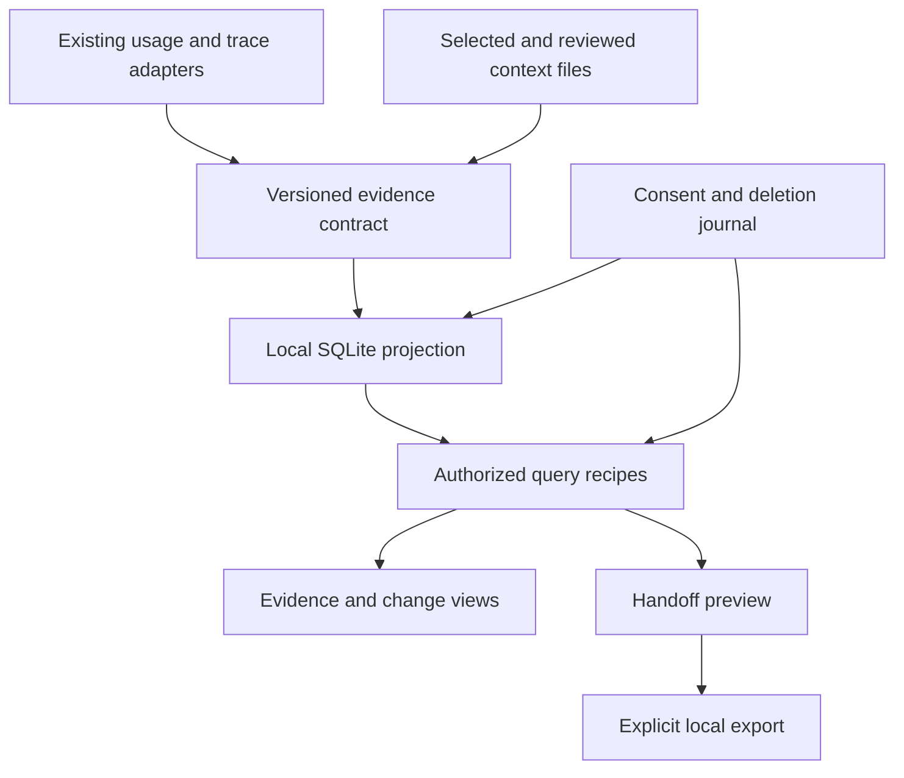

# Token Horizon: knowledge graph integration

## Track 3 research and implementation specification

**Research date:** 18 November 2026, Australia/Melbourne.  
**Repository baseline:** `castlemilk/token-horizon`, branch `main`, commit `b468206e9378c8d7a6788b67072494982e7de17d`.  
**Commit time:** 18 November 2026 at 07:35:19 UTC / 18:35:19 AEDT.  
**Status:** read-only research, original design proposals, and a standalone synthetic reference experiment. No product implementation, repository mutation, deployment, publication, customer outreach, or paid inference was performed.

All proposed API routes, schemas, controls, work estimates, performance budgets, and UI views below are **proposals** unless explicitly marked as measured in the reference experiment. That experiment is not Token Horizon code and does not validate its production authorization or performance.

---

## Executive recommendation

Build a **local evidence and context layer** that answers three concrete questions:

1. **What approved project context should I carry into the next tool?**
2. **Why is each item included, and which exact source supports it?**
3. **What became stale, contradicted, inaccessible, or deleted since this bundle was prepared?**

Start with reviewed, versioned handoff files and deterministic relationships. Use a small SQLite projection for source dependencies, bounded retrieval, and explanations when ordinary manifest comparison becomes insufficient. Keep token accounting in its existing owners. A new graph database, automatic transcript extraction, and hosted private-memory synchronization are not prerequisites.

This recommendation extends the existing [knowledge and memory plan][P02], [research roadmap #12][I12], and [reviewed handoff issue #16][I16]. They already establish the relevant product direction. The graph is an implementation technique for that work, not a separate memory platform or new generic epic.

### Why this fits the actual repository

The inspected source contains several useful foundations, but they differ substantially:

- The native macOS app computes usage from provider histories, maintains in-memory aggregates, and persists JSON caches and parser state. Its SQLite use includes read-only upstream databases; it does not already own the portable daemon's canonical usage database. [R03], [R04]
- The portable Go daemon owns a SQLite usage store, including event, annotation, pricing, context-occupancy, and trace tables. Some file imports are coarse aggregates, not request records. [R05], [R07]
- The standalone Go gateway keeps a separate, richer JSONL trace contract with a bounded memory view. Its session identifiers and retry fingerprints are evidence requiring interpretation. [R09], [R10], [R11]
- Hosted Cloudflare code serves published profiles/catalog data and controlled reports. Public team membership is not a private knowledge-workspace permission model. [R14], [R15], [R16]

No dedicated knowledge graph storage or context-bundle API was found in the inspected stores/routes and targeted code searches. Searches for `knowledge_graph` and `context_bundle` returned no matches. Inference-engine embeddings and command graphs are not evidence of an application knowledge graph. This is a scoped source finding, not proof about every possible external deployment.

### First deliverable and investment gate

Prototype one project moving from a reviewed context bundle into a second supported harness. Begin with explicit local export or user-selected attachment, preserving existing instruction files. The first product view should be an evidence list and change summary, with a small graph as an optional explanation.

A **5–8 engineering-day discovery prototype** is a planning estimate for local manifests, selected-source review, deterministic change detection, and a basic preview. A more complete native/local-MCP implementation, including identity, authorization, deletion, retrieval and regression gates, is estimated at **24–39 engineering days** in the backlog below. These are unvalidated estimates, not commitments or measured velocity. A second platform implementation, hosted team synchronization, and semantic extraction are additional work.

Promote graph-assisted retrieval only when a controlled comparison beats the best inexpensive alternative. If a plain manifest plus search gives equivalent results, keep it. The value to test is successful continuation and reliable evidence recovery; node counts, attractive diagrams, and reduced prompt length do not establish that value.

---

## 1. Evidence, provenance and limits

### 1.1 What was actually inspected

| Evidence class | Inspected evidence | What it establishes | What it does not establish |
|---|---|---|---|
| **Current source** | `main` at the exact commit above; complete recursive tree, 2,031 entries, `truncated=false`; selected Swift, Go, gateway, MCP and Worker files | Reproducible source contracts and implementation seams | That every source feature is released or running |
| **Published release** | GitHub latest release `v0.5.2`, published 28 October 2026 at 07:33:44 UTC; annotated tag resolves to commit `4ebad0b69c3113509f974438e46238631d52d77c`; DMG, ZIP, checksum and film assets listed | Published release metadata and asset inventory | Binary contents, installation success, current native runtime behavior |
| **Current public product** | Anonymous HTML at `https://token-horizon.dev/`, `/docs/`, `/connect`, reached from the repository README; read-only hosted overview | Public positioning, documentation and hosted scope | Authenticated workflow completion, rendered interaction quality, deployment commit |
| **Current hosted metadata** | Hosted overview returned `mode: hosted` and stated published community scope without device traces | A successful read in the hosted connector's declared scope | Access to local gateway, private history or graph data |
| **Backlog** | All-state issue collection: page 1 returned #1–#46, page 2 empty; all bodies obtained; relevant PR metadata and comments inspected | 31 ordinary issues, all open; 15 PRs: 12 merged, one closed unmerged, two open drafts | Closure as a synonym for implementation or deployment |
| **Project context** | Root research page, Knowledge and memory integration, Harness and gateway integration design | Existing decisions and proposed boundaries, dated below | Their older source snapshot as the current code baseline |
| **Measured here** | Standalone synthetic SQLite experiment in `reference/` | Behavior of this reference model on its fixtures | Product security, real retrieval utility, native performance or user demand |
| **Proposed** | This specification, contracts, wireframes and staged backlog | Reviewable design choices and acceptance gates | Shipped product functionality |

Source pin and release evidence: [R01], [R02]. Product reads: [W01], [W02], [W03]. Issue coverage URLs are preserved in the evidence register. Issue and PR states are a dated snapshot, not a promise that the repository has stopped changing.

The public landing page labels its demo and community preview as illustrative. Those example values were not treated as real usage or validation results. The research did not call individual profile/account tools or export personal usage records.

### 1.2 Existing context reconciled

The root research page was updated on **16 November 2026 at 23:44:11 UTC**. The memory page was updated on **11 November at 00:31:25 UTC**, and the harness design page on **11 November at 00:31:15 UTC**. The earlier research used commit `81441e5cef64ad49fae59458cee066e9195113d8`. This study retains its reviewed-handoff direction while replacing implementation assumptions with the newer source audit. [P01], [P02], [P03]

The prior plan distinguishes context availability, return and observable insertion, and explicitly treats usefulness as unproven. It favors plain versioned files before a larger memory engine. This specification adds concrete identity, temporal, authorization, query and deletion contracts to that direction. It does not silently convert existing proposals into completed features.

### 1.3 Exact access and validation gaps

- No user-installed macOS, Windows or Linux runtime was available for this investigation. No product binary was built or launched.
- The public `/api/health` URL could not be retrieved through the web research tool. That failure does **not** establish an outage. No current hosted build hash was obtained.
- The runtime-configured service receiving Go `/ingest/events` traffic was not identifiable from inspected source. Searches found the client and tests, not its server schema or authorization implementation. A DuckDB comment is not evidence of a deployed DuckDB backend. [R13]
- The original November research conversation and original image attachments were not inspected. Three linked text Pages were read directly; other cross-track Pages remain outside this study.
- Native source security concerns were not tested against a live listener. Findings are static observations, not reproduced exploit claims.
- No product inference or embedding pipeline, customer interviews, commercial demand tests, real-user continuation trials, or production performance benchmarks were run.
- Existing repository test scripts were not executed. In particular, issue #39 records live dependencies and conditional publishing in the default MCP test chain; this study used its own hermetic reference experiment. [I39]

---

## 2. Current data model, ingestion and APIs

### 2.1 Source map and implications

| Component | Actual current source | Integration consequence |
|---|---|---|
| Native usage model | `Usage/Models.swift`: `UsageSnapshot`, `SessionSummary`, `ProjectUsage`, `ParserHealth` | Reuse aggregate and coverage fields; add stable scoped identity separately |
| Native persistence | `Persistence/DurableStore.swift`: snapshots/history/trends/limits/engine-state JSON; parser-state version 5 | Do not describe a pre-existing native graph or canonical SQLite usage ledger |
| Native parsers | `Usage/UsageEngine.swift`: per-file offsets, watermarks, hourly buckets, bounded reads, change-driven scans | Observe existing collection output; keep graph work off parser locks/UI paths |
| Portable local store | `daemons/go/internal/store/schema.go` | Usable relational foundation; additive graph projection can use ordinary SQLite |
| Portable point capture | `capture/meter/meter.go` | Same exchange ID joins a local event and trace when both are retained; session identity is not reliably populated |
| Portable file import | `capture/files/codex.go`, `backfill.go`, `projects.go` | Preserve source grain, inferred paths and import attestation; do not invent request lineage |
| Standalone gateway | `gateway/trace.go`, `store.go`, `usage.go` | Rich request metadata, but bounded coverage and heuristic session/retry relationships |
| Local MCP | `mcp/token-horizon-mcp.mjs` | Extend existing discovery/dispatch with capability-specific knowledge tools; do not parse provider files again |
| Hosted service | `cloudflare/src/index.js`, `team-invites.js`, `connector.js` | Published community data and report controls are distinct from a future private knowledge service |
| Optional analytics sync | `daemons/go/internal/cloudsync/sync.go` | Receiving service and deletion semantics need separate verification before reuse |

Detailed pinned references: [R03]–[R18]. The evidence register records file paths and blob SHAs for the inspected snapshot.

### 2.2 The native model is useful but not a stable entity graph

`ProjectUsage.id` is its directory string. `SessionSummary` contains an ID, title, directory, created time, provider/model and usage. Its compatibility decoder can create a new UUID and current timestamp when older data lacks them. Graph import must record that these are fallback values rather than treating them as source-established identity or event time. `ParserHealth` records parsed/suspect lines since launch and is a useful coverage signal, not a completeness guarantee. [R03]

The graph should retain an opaque, user-confirmed project ID and separate private machine/path aliases. Existing project aggregates can attach to that identity only after an explicit mapping. A folder basename is unsuitable for merging two clients' work or two repositories with the same name.

### 2.3 The portable schema and accounting grain

The Go schema defines `usage_event`, `context_state`, `limit_snapshot`, `file_annotation`, `spelling`, `pricing`, `sync_state`, `machine` and `trace`. `context_state` is numerical session occupancy, not stored project knowledge or evidence that a model used a fact. The presence of a table also does not prove every producer populates it. [R05]

Portable usage rows preserve raw vendor/model, source, time, machine, optional request/session identifiers, product provenance, attestation and cost information. They lack the tenant/project/human identity model needed for shared knowledge. The store uses event UUID insertion deduplication; this does not by itself establish cross-source equivalence. [R05], [R06]

A particularly important limitation is the historical file importer: it produces five-minute buckets with an import model marker and self-reported attestation. Its deterministic identity uses tool and bucket, so a future multi-device projection must add its own source/machine namespace. A graph may represent `UsageBucket → source/tool`, but cannot manufacture `Request → Session → Task` from this aggregate. [R07]

### 2.4 Preserve token semantics instead of creating a second accounting model

The portable DTO uses five disjoint components: uncached input, non-reasoning output, reasoning, cache-read input, and cache-write input. Non-reasoning output may include tool-call output; it does not imply only text visible to the user. Native/provider inputs can use different overlapping conventions. Graph references must carry `counter_semantics_version`, `grain`, `measurement_kind`, and `usage_coverage`; numerical totals remain computed by their canonical owner. [R06]

For a **synthetic inclusive-provider example**, raw input of 1,000 including 600 cache tokens and raw output of 200 including 80 reasoning tokens normalizes to 400 uncached input + 600 cache read + 120 non-reasoning output + 80 reasoning = 1,200. Adding cached/reasoning values again to inclusive totals would be wrong. This example is not a new provider contract.

When a legacy row has lost the distinction between missing and zero, the adapter must report `legacy_unspecified` coverage. It cannot recover missingness by guessing from a zero value. A graph projection must never “correct” billing or usage through a semantic assertion.

### 2.5 Identity traps found in source

| Existing value | What it really supports | Required graph treatment |
|---|---|---|
| Go `account_id` | Vendor plus a truncated credential hash | Credential pseudonym, never human identity or authorization |
| Gateway `sessionKey` | Header, declared conversation/session, previous-response reference, or metadata user value | Preserve the origin and different relation meanings; unresolved until validated |
| Retry fingerprint | Repeated normalized input within a window | `REPEATED_INPUT_CANDIDATE`, not confirmed retry or duplicate charge |
| Provider request ID | Source/provider-scoped identifier with variable coverage | Namespace by provider/account/source contract; reject ambiguous joins |
| Project directory recovery | An inferred path from provider folder conventions | Private alias candidate; user-confirm repository/worktree mapping |
| Family-normalized model | Aggregate display identity | Keep exact requested alias, returned model version and provider listing separate |

The account pseudonym, session-key and project-path findings are grounded in [R08], [R11], [R07]. The current annotation query matches a request ID without including vendor even though the annotation key includes vendor; this is a source-level ambiguity to avoid inheriting in graph joins, not a demonstrated production incident. [R06]

Shared API keys must not merge people. Key rotation must not create a new person. Email matches across identity-provider namespaces must not grant access. A fuzzy name match may create a review candidate; it must not mutate canonical identity automatically.

### 2.6 Trace coverage, privacy defaults and API differences

| Contract | Standalone gateway | Portable daemon |
|---|---|---|
| Storage | JSONL day files plus a 200-record memory ring | SQLite trace table |
| Timestamp | Request start | Exchange completion |
| Trace richness | Requested/returned models, provider IDs, tool calls, completion/coverage and session hints | Narrower trace metadata; many fields do not exist |
| Session route | `/traces/sessions` | No corresponding route in inspected daemon API |
| Body policy in source | Metadata-only default; body persistence requires `TOKEN_HORIZON_CAPTURE_BODIES=1` | Active meters default to trace persistence; configuration can disable the entire trace |
| Query scope | Recent ring; cold hydration bounded by days, bytes and count | Retained SQLite rows |

Sources: [R09], [R10], [R12], [R17]. Do not assume local MCP feature declarations imply every `:8889` producer implements the same routes.

The Go daemon's `traceCapture:false`, absent an enabling environment override, suppresses new trace records entirely, including metadata and bodies, while usage collection continues. The gate is cached up to 30 seconds and does not delete old traces. This differs from metadata-only trace capture. The gateway's seven-day filter also does not establish complete seven-day coverage because its APIs read the bounded ring. These distinctions must be visible in knowledge-source capabilities. [R10], [R12]

### 2.7 Hosted state is a separate boundary

Cloudflare stores published profile data in R2 and has explicit report audience checks. Fresh account membership participates in restricted report reads; public handles and labels are not credentials. A SQLite-backed Durable Object exists for OAuth grant coordination. It is not a knowledge store and should not be reused to hold graph content. [R14], [R15], [R16]

Native publication can include project labels and session metadata; titles are conditional on a separate setting. This shows why “no raw prompts” is not equivalent to “no sensitive metadata.” A future private knowledge projection must use a positive export allowlist instead of extending the existing profile payload with new fields. [R18]

The separate Go sync client has no graph deletion dataset, and its cursor scope does not encode target/principal/consent version. Its receiving service remains unverified. Shared graph synchronization should therefore be deferred rather than appended to that protocol. [R13]

---

## 3. Prioritized graph use cases

The value ratings below are hypotheses grounded in existing product direction and available source structure. They are not observed demand or adoption.

| Priority | Concrete question | Minimal useful relationship | Why it helps | Baseline and gate |
|---|---|---|---|---|
| **P0** | What changed since I prepared this handoff? | Bundle version → included context/source versions → replacements or tombstones | Prevents carrying obsolete constraints into the next session | Manifest diff; use graph only if dependency expansion improves accuracy/workflow |
| **P0** | Why is this context item here? | Context item → reviewed assertion → source revision and safe locator | Gives an inspectable reason to trust, reject or edit an item | Explicit joins and evidence list; 100% of included items need authorized provenance |
| **P1** | What should I carry from this task into Codex/Claude Code? | Task → approved bundle → decisions, constraints, verification | Supports reviewed continuation across tools | User's existing manual handoff and filtered text search, under equal budget |
| **P1** | What else is invalidated if I delete or revoke this source? | Source → jointly derived assertions → bundle/index/export dependencies | Makes deletion and stale-context detection reliable | Relational dependency walk; mandatory correctness gate independent of UI |
| **P1/P2 dependency** | Why was this request attributed to this model/project/cost? | Observation → attribution evidence → model/listing/price revision | Explains ambiguity and estimates without inventing causes | Existing relational attribution; owned jointly with analytics/context tracks |
| **P2** | Which approved team guidance applies to this project now? | Private workspace/project → authorized guidance revisions | Useful controlled reuse across sessions and people | Requires separate private membership/scopes and demonstrated local utility |
| **Defer** | What themes exist across every conversation? | Extracted entities/communities → generated summaries | Potential corpus sensemaking | Needs authorized corpus, extraction evaluation and real demand; not justified now |

Do not build an employee “knowledge score,” infer productivity from graph centrality, or call a correlation a causal performance improvement. Context relationships can explain what was offered or returned; they do not expose hidden model attention or prove a fact was used.

Microsoft GraphRAG research concerns global sensemaking over large text corpora. That supports a later hypothesis, not a claim that graph retrieval improves this product's exact usage joins. Its indexing documentation also identifies extraction costs and the limitations of simpler co-occurrence graphs. [W15], [W16]

---

## 4. Minimal architecture and storage decision

### 4.1 Proposed ownership

**Authoritative data remains where it belongs:** provider observations in existing collectors; approved context in versioned local manifests/files; authorization and tombstones in the knowledge service's local ledger. SQLite graph/search tables are a derived read model. The graph stores references and safe reviewed text, not a second copy of all provider histories.



**Native owner:** add a feature module beside `Usage/` and `Persistence/`; reuse the system SQLite library already available to Swift, but create a dedicated knowledge database. Do not repurpose the upstream OpenCode connection or mutate provider databases.

**Portable owner:** add the same versioned contract to the Go daemon using its existing SQLite driver. Prefer a dedicated projection file/module so the current usage schema and retention rules remain independently reviewable. One installed core owns the local API; do not run a second parser or knowledge daemon competing for `:8889`.

**Initial support scope:** one native platform plus local MCP is enough to establish utility. Port the schema/query fixtures to the other core before claiming parity. A common contract does not mean the current runtimes already have equivalent telemetry.

**Hosted owner:** none for the first increment. If private team sharing later passes its gates, use a separate authenticated private service/store and explicit consent. Do not place private graph state in `leaderboard.json`, public profile pages, the catalog export, or the OAuth grant object.

### 4.2 Why SQLite first

| Option | Appropriate use | Tradeoff | Decision |
|---|---|---|---|
| Versioned JSON/Markdown manifests | Small reviewed handoff with exact source references | Excellent inspectability; cross-bundle dependency queries become cumbersome | **Start here** |
| SQLite tables, adjacency indexes and optional FTS5 | Deterministic lineage, two-hop evidence, change/deletion dependencies | Application must implement row/scope policy; one writer; careful index lifecycle | **Preferred local index** |
| New embedded graph database | Complex path workloads demonstrated to exceed SQL approach | New packaging, migration, operational and query-policy surface | No present justification |
| Hosted SQLite/Durable Object per private workspace | Later transactional team state on existing hosting stack | Extra product/consent/backup/offline consistency obligations | Candidate only after private-team gate |
| External memory/graph service | A specific retrieval/extraction capability demonstrably better than local baseline | Network content exposure, cost, deletion and identity portability | Optional adapter after evaluation |

SQLite supports recursive graph queries, but a fixed-depth join or service-managed breadth-first walk may be easier to audit when authorization is complex. WAL supports reader/writer concurrency, not multiple concurrent writers or a shared network-filesystem database. Long-running graph work must not block ingestion. [W05], [W06], [W07]

A dedicated graph engine becomes a decision only after a named workload misses a justified requirement despite query-plan/index work. Neither a graph visualization nor a growing entity count is sufficient evidence.

### 4.3 Ingestion and rebuild protocol

1. Select an approved source adapter and record producer/build/schema, source identity, permission basis and data grain.
2. Read a stable source revision without mutating it. For files, read bounded bytes, verify the file/version did not change during the read, then retry or mark stale if it did.
3. Normalize identifiers, time/counter semantics and evidence class. Keep unknown values unknown.
4. Reject or quarantine unsupported schema/content. A failed parser updates coverage status; it does not silently certify an empty source.
5. Commit projection changes, source cursor and journal sequence together inside the knowledge database. The source store itself may be a different file/process; do not claim a distributed atomic transaction across both.
6. Rebuild deterministically from approved manifests and retained source revisions. Apply tombstones before exposing rebuilt content.
7. Emit source watermarks, graph revision, policy epoch, missing sources and truncation to the internal query layer. Externally expose only authorized source coverage and an opaque view snapshot.

For the native app, use a background serial writer and short transactions. Copy a safe collector snapshot before enqueueing graph work; do not hold `UsageEngine` locks while indexing or extracting. If projection ingestion falls behind, usage tracking continues and graph views show lag.

---

## 5. Entities, edges, provenance and time

### 5.1 A small domain model

| Entity or record | Identity and version rule | Evidence and sensitivity |
|---|---|---|
| Workspace | Opaque local/private UUID; separate from public team membership | Server/device authority determines access |
| Project | Workspace-scoped UUID; repo/worktree aliases are reviewed mappings | Path/remote can reveal client work; keep opaque outside authorized detail |
| Task | Explicit task ID and revision | No automatic task inference from prompt text |
| Session reference | Source namespace plus declared ID and semantic kind | A user value or parent-response ID does not become a session silently |
| Attempt / observation | Exact source observation ID plus producer/device namespace | One logical request may have distinct attempts and multiple observations |
| Source revision | Immutable revision ID, safe locator, source version and digest policy | Raw path/content stays private unless specifically selected |
| Context item | Versioned decision, constraint, task state, preference, verification or reference | Separate factual statements from instructions; review state required |
| Bundle | Immutable ordered manifest of approved versions and destination projection | Export changes create a new version; review binds exact content |
| Model/configuration | Exact requested alias, returned ID, listing and relevant configuration version | Family aggregation remains a separate relation |
| Identity-resolution decision | Candidate/approved/rejected merge or alias, reviewer and reason | Reversible; never authorizes access by itself |
| Delivery receipt | Available/requested/returned/inserted evidence with adapter/version | Absence of a receipt is unknown, not “not used” |

The reference schema deliberately uses version IDs at graph endpoints. Stable logical IDs group revisions, while historical edges continue pointing to the version that actually supported a bundle.

### 5.2 Allowed relation vocabulary

| Relation | Meaning | Evidence requirement |
|---|---|---|
| `IN_PROJECT` | Explicit project assignment | User mapping or source contract |
| `INCLUDES` | Bundle contains exact context/source version | Manifest entry |
| `SUPPORTED_BY` | Assertion relies on a source revision | Authorized safe locator and evidence method |
| `CHECKED_REVISION` | Verification covers an exact source revision | Verification record and pinned revision |
| `DERIVED_FROM` | Output was generated from these inputs | Complete input-version manifest and transform version |
| `SUPERSEDES` | Reviewed correction replaces a prior item | Explicit replacement decision and temporal scope |
| `CONTRADICTS` | Two claims conflict in an overlapping scope | Both claims retained; no automatic winner |
| `OBSERVED_AS` | Raw identity is observed with an exact resolved value | Producer-established relationship |
| `PRICED_USING` | Calculation used a particular rate revision | Exact pricing provenance and cost class |
| `PARENT_RESPONSE_REF` | Response references a prior response | Source identifier; not a session merge |
| `RETURNED_TO` | Adapter returned content to an identified client request | Transport receipt only |
| `INSERTED_IN` | Harness attested to prompt insertion | Explicit supported harness evidence |
| `ALIAS_CANDIDATE` | Possible equivalent identity | Candidate status; never used as trusted authorization/merge |

Verification of one revision does not automatically validate a replacement revision.

A co-occurrence or semantic similarity relation must remain a suggestion. It must not become `DEPENDS_ON`, `CAUSES`, or a factual instruction merely because its score is high. W3C PROV supplies useful distinctions between entities, activities and derivations; adopting those ideas does not require RDF or a new storage engine. [W17]

### 5.3 Evidence classes and provenance envelope

Use a closed set of evidence methods, such as `source_reported`, `exact_identifier_join`, `user_reviewed`, `deterministic_transform`, `heuristic_candidate`, and `model_extracted_candidate`. Store method-specific confidence separately from review state. A numeric confidence is not permission and should not be shown as a calibrated probability unless it has actually been calibrated.

**Proposed example; synthetic data:**

```json
{
  "workspace_ref": "ws_demo_a",
  "version_id": "decision_orion_v3",
  "logical_id": "decision_orion",
  "kind": "ContextItem",
  "content_kind": "decision",
  "review_state": "approved",
  "text": "Keep provider observation identity separate from task identity.",
  "evidence_method": "user_reviewed",
  "source_refs": [{
    "source_revision_id": "source_orion_r7",
    "locator": {"kind": "record", "record_id": "review_17"},
    "observed_at": "2026-11-18T07:00:00Z"
  }],
  "valid_from": "2026-11-17T00:00:00Z",
  "valid_to": null,
  "recorded_from": "2026-11-18T07:02:00Z",
  "recorded_to": null,
  "required_scopes": ["project_orion"],
  "supersedes": "decision_orion_v2",
  "extractor_version": null
}
```

Production records additionally need schema version, author/reviewer authority, retention/expiry, source permission basis, transformation version where applicable, and integrity metadata. The reference experiment models core relational invariants, not every production field.

### 5.4 Temporal semantics

Keep five clocks separate:

- **Occurred at:** source event time, including whether it represents request start/completion or a bucket interval.
- **Valid interval:** when the fact is asserted to apply.
- **Recorded interval:** when Token Horizon knew that version.
- **Indexed through:** source revision/cursor included in the current projection.
- **Retrieved at:** time of the user's query.

Known intervals are half-open: `[start, end)`. Unknown validity remains unknown; it is not set to ingestion time. An exact historical query must exclude unknown-validity claims or return them in an explicitly uncertain section, rather than presenting them as true at the requested date.

For example, a correction may arrive on 18 November but apply from 16 November. “What applied on 17 November using what we knew on 17 November?” must return the old known view; the same valid date using knowledge as of 18 November may return the correction. Preserve older content; atomically close its recorded interval and insert corrected versions, or derive the intervals from an append-only correction ledger. The reference fixture uses preclosed intervals and does not implement that production correction writer.

Current authorization, retention and deletion always constrain historical reads. `known_at` is not a mechanism to restore access revoked today. An old export can remain recorded as a version reference while its deleted content is unavailable.

### 5.5 Entity resolution rules

Resolve only within an authorized workspace and explicit namespace. Use exact source IDs or confirmed mappings where possible. Keep the following separate:

- Verified person/account subject versus credential pseudonym.
- Repository versus worktree versus local directory.
- Task versus session versus response parent versus individual attempt.
- Model family versus dated model version versus provider offer versus routing alias.
- A repeated source observation versus a second genuine request with identical input.

A resolution operation records prior identities, reviewer, evidence, scope and version. A split restores the prior distinct identities and rebuilds affected projections. No cross-tenant global identity service is needed. Shared public catalog identifiers may be referenced by private nodes, but cannot become a traversal bridge between private workspaces.

---
## 6. Retrieval, explanation and performance

### 6.1 Three query recipes, not an arbitrary graph language

Support a small registry of server-owned recipes:

| Recipe | Seeds | Expansion | Output |
|---|---|---|---|
| `resume_task` | Explicit project and task | Approved context → required evidence and current verification | Ranked, bounded context candidates with citations and omissions policy |
| `explain_context` | Context version or bundle item | Assertion → source revision → review activity | Exact reason for inclusion, temporal state and evidence locator |
| `changes_since_bundle` | Immutable bundle version | Included revisions → supersession, expiry, conflict or deletion | Authorized change list and whether export needs a fresh review |

Do not accept arbitrary SQL, Cypher, filesystem paths, URLs to fetch, or unrestricted edge names from an MCP model. A request supplies opaque IDs and bounded parameters. Recipe implementations use prepared statements and fixed relation allowlists. Imported instructions are inert data. Opening a source or applying an instruction is a separate user action.

A query proceeds as follows:

1. Authenticate the caller and derive its workspace from the verified capability. The body does not choose a tenant.
2. Load current membership, scopes, consent, policy epoch, graph revision and deletion generation. Deny if required state is unavailable.
3. Resolve seed IDs inside that workspace. Return the same generic unavailable response for missing and inaccessible seeds.
4. Materialize or query an authorized candidate relation. Evaluate each node, edge, endpoint and **every required evidence source before expanding** it.
5. Apply valid-time and recorded-time predicates. Intersect them with current rights and current deletion state.
6. Traverse approved relation types with cycle detection and strict work budgets. A hidden intermediate cannot connect two otherwise visible nodes.
7. Rank only authorized candidates; build explanations only from authorized support. Recheck source versions, policy epoch and graph revision before releasing content.
8. Return visible results, coverage and truncation state. Do not reveal hidden labels, hidden counts, private degree, suppressed paths or why a particular inaccessible item exists.

A derived assertion that jointly depends on three sources requires access to all three. “At least one visible citation” is insufficient. Independent evidence can support separate assertion versions; losing one source may leave another independently justified assertion available. The system must record that distinction rather than arbitrarily retaining a combined summary after one support is removed.

### 6.2 Full-text search and ranking

FTS5 can provide lexical matches over approved text. Treat it as a rebuildable derived index, with synchronized updates and deletion. Do not use a shared-corpus BM25 score after simply filtering the returned rows: corpus-wide document frequencies can let hidden documents influence visible ranking. For the first implementation, authorize candidate IDs before scoring and top-k selection, using only visible features or an isolated authorized corpus. A pre-authorization candidate cap must not silently remove visible matches when hidden matches are added. On a global work-budget interruption, return a generic incomplete/failure state rather than a misleading complete top-k. Avoid global hit counts and snippets generated from unavailable content. This ranking rule is a proposed noninterference requirement, not a claim that SQLite implements row-level authorization. [W08], [W13]

Use exact matches and reviewed relations first. Suggested similarity links should remain outside automatic export. Candidate text may later be embedded only with separate consent, a recorded model/version and a demonstrated benefit over lexical search. An embedding is derived sensitive content and inherits its source's authorization and deletion requirements.

Initial scoring can be transparent: approved status, exact task/project match, source freshness, specific relation type and recent verification. Do not present the weighted score as a probability of truth. Keep confidence in extraction separate from review status, factual validity and source availability.

### 6.3 Proposed service budgets

The following are starting acceptance targets, **not observed Token Horizon performance**:

| Dimension | Initial proposal | Reason / validation |
|---|---|---|
| Traversal depth | Default 1, hard maximum 2 hops | Keeps explanations local and reviewable |
| Returned graph | At most 200 nodes and 500 edges | Prevents unusable diagrams and large responses |
| Per-node expansion | At most 25 permitted adjacent edges per recipe | Bounds high-degree entities; report authorized truncation |
| Work budget | At most 5,000 candidate visits plus execution cancellation | Output `LIMIT` alone does not cap underlying work |
| Response | At most 256 KiB including provenance | Enforced byte limit independent of token estimates |
| Suggested context | Default estimated budget 4,096 tokens | Model-specific estimation; never label as observed usage |
| Interactive query | Target p95 ≤250 ms at 100k nodes / 500k edges on named reference hardware | Future stress test with cold/warm cache and competing ingestion |
| Cancellation | Hard service deadline 1 second; promptly interrupt SQLite work | Return explicit timeout, not an apparently complete result |
| Projection freshness | An adapter-observable source revision indexed within 5 seconds under nominal load | Report upstream observation lag separately from projection lag; no real-time claim |
| Rebuild | Resumable batches, bounded queue and cancellation | Metering/UI remain responsive; never hold parser locks during indexing |

SQLite supports bounded recursive queries and cancellation through its progress callback. WAL permits concurrent readers but retains a single writer; long transactions and competing projection work still require measurement. A separate per-workspace graph file is attractive for isolation and rebuilds, but it cannot provide an atomic transaction with a separate usage database or JSON source. Use a durable change journal, idempotent import and revision checks rather than claiming cross-store atomicity. [W05], [W06], [W07], [W14]

Measure local CPU time, rows visited, index bytes, write amplification, queue lag and query p50/p95/p99. For any future hosted mode, also measure object reads/writes, storage, egress, extraction tokens and support burden per active workspace. No embeddings or model extraction are required in the initial cost model. A cost forecast must use measured workload and current tariffs; this study supplies neither a fabricated monthly price nor a paid benchmark.

---

## 7. Authorization, privacy and lifecycle contract

### 7.1 Private workspaces and explicit capabilities

Private graph tenancy must be a new explicit contract. A personal workspace belongs to one verified account/device authority. A team workspace belongs to an explicit private organization/project membership, not to an overlapping public leaderboard team. Do not infer graph access from an email, public handle, API-key pseudonym, aggregate report role, or hosted `account:read` scope. [R08], [R14], [R15], [R16]

Proposed capabilities are independent:

- `knowledge:metadata:read` — only permitted labels and structural metadata, themselves potentially sensitive.
- `knowledge:content:read` — approved content plus its required evidence.
- `knowledge:curate` — create or review local context records inside the caller's source permissions.
- `knowledge:export` — export content already readable to an approved destination.
- `knowledge:delete` — remove an owned source or exercise an explicitly delegated lifecycle operation.
- `knowledge:admin` — manage workspace policy; does not automatically grant content access.

The team-management track should define product roles that map to these capabilities. The graph service must enforce the resulting object and source grants on each request. Roles alone are insufficient where projects have different confidentiality boundaries. OWASP's guidance supports deny-by-default and per-request authorization; the detailed traversal policy here is a design proposal. [W12]

Every ordinary graph primary/foreign key includes `workspace_id`. A version reference is `(workspace_id, version_id)`, not a globally joinable free-form ID. Endpoints, evidence, scopes and dependency edges are constrained within that namespace. Public model/catalog identifiers may be referenced from private graphs through a one-way lookup; public nodes must never provide a route between private tenants.

SQLite's authorizer callback is a statement/table/column control, not a substitute for per-row graph policy. Encapsulate queries behind one service, prohibit direct client SQL, and test every recipe against adversarial fixtures. Separate database files reduce accidental joins but do not remove the need for correct application authorization. [W13]

### 7.2 Local transport prerequisite

Before exposing knowledge content, harden the relevant local transport. The portable daemon and standalone gateway explicitly bind loopback; the inspected native listener does not show an explicit loopback endpoint requirement and passes parsed method/path/body without a demonstrated graph-auth context. The native and portable APIs also contain permissive CORS behavior. These are static source observations; no live exposure or exploit was reproduced. [R12], [R17], [R19]

A content-bearing endpoint needs explicit loopback binding or a protected local socket, per-client capabilities, secret-safe credential storage, strict request size limits, Host/origin validation for browser clients, and current scope checks. CORS is not authentication; an origin check does not authenticate native clients. Do not add private graph endpoints to the current unauthenticated route pattern and rely on “local” as the security model. A read-only query can still disclose private content.

### 7.3 Consent and redaction

Metering consent, trace capture, public profile publication, team membership and homepage analytics are distinct from permission to index or share project content. Ask for explicit knowledge-source selection and describe the local/remote destination before capture. Default to metadata and manually approved context; do not bulk ingest all histories or transcript bodies.

Use a positive content allowlist and safe synthetic examples. Locators should identify a source revision without exporting a home directory, access token, raw prompt, private repository title or collaborator identity. Keep private locators encrypted or OS-protected locally, with human-readable labels created for the intended audience. Hashing a sensitive path or low-entropy secret does not make it anonymous; use keyed, workspace-scoped integrity identifiers where necessary.

Redaction is a versioned transformation: preserve its rule/version, original source reference, output scope and review state. A summary inherits the intersection of all contributing source restrictions. Removing a name does not automatically authorize sharing. If a reviewer creates a separately shareable statement, record an explicit declassification decision under policy, with a new version and evidence that the remaining content is permitted. Automated secret scanning is an aid, not a proof that text is safe.

### 7.4 Proposed retention choices

These are conservative initial product defaults for review, not existing settings or legal conclusions. The user/workspace policy may choose shorter periods; a derived record must never outlive a stricter source policy.

| Data | Proposed default / limit | Important condition |
|---|---|---|
| Unreviewed candidates | 7 days | Automatically expire; never export |
| Opted-in indexed content | 30 days or source expiry, whichever is sooner | Explicit extension required; avoid indefinite background transcript storage |
| Reviewed bundle | 90 days or earliest included-source expiry | Version references may remain after content disappears; mark unavailable |
| Search/result cache | Up to 5 minutes | Policy epoch, graph revision and deletion generation checked on every read |
| Export preview | 15 minutes | Bind source versions, destination, hash, policy epoch and graph revision |
| Service-managed download | Up to 24 hours | Re-authenticate each retrieval; no public bearer URL by default |
| Minimal audit receipt | 90 days | Opaque identifiers and action outcomes only; no payload text or private labels |

Some reviewed project decisions may need longer retention. That is an explicit policy change, not a reason to retain every underlying conversation indefinitely. A desktop backup or user-created file may outlive application deletion; the UI must describe that boundary.

### 7.5 Deletion and revocation propagation

On source deletion, revocation or expiry:

1. Authorize the lifecycle operation separately from content reading, so an authorized owner can erase a revoked/expired source. Commit the new source state and a monotonic deletion/revocation generation before further reads.
2. Block all affected nodes, edges and jointly derived assertions immediately at query time.
3. Walk the recorded dependency closure, including summaries, chunks, embeddings, FTS entries, bundles, previews and managed shares. Tombstone or invalidate each dependent record as appropriate.
4. Remove indexed payloads and queued work. Clear policy-bound caches and cancel pending exports.
5. Prevent replay or a late offline device from resurrecting deleted revisions. Tombstones take precedence over older import cursors; deliberate re-import needs fresh consent and a new source generation. Retain replay barriers until every accepted replica/cursor is beyond the deleted generation or has been retired; the 90-day audit-receipt default is not a tombstone expiry.
6. Recheck downloads and export release against current state. Report a deletion receipt with local logical removal, physical cleanup, synchronized copies and uncontrolled exports as separate statuses. Receipts must not reveal otherwise hidden descendants or their counts.

An already exported file cannot be recalled by deleting a graph row. A service should revoke controlled shares and record the limitation for external copies. Offline team clients cannot simultaneously promise indefinite access and immediate revocation; choose online authorization for sensitive content or a short, explicit lease, and describe the residual window.

Logical disappearance is not physical erasure. SQLite tables, FTS shadow structures, WAL/journals, snapshots, operating-system backups and remote caches require separate retention and cleanup procedures. FTS secure-delete behavior is version-sensitive. A cloud object deletion also does not by itself invalidate a cached custom-domain response. Do not issue a “fully erased everywhere” receipt based only on successful SQL `DELETE`. [W08], [W09], [W11]

---

## 8. Proposed schema and API contracts

The runnable relational example is in `reference/schema.sql`; its synthetic fixture and invariant checker are separate from the repository. `contracts/openapi.yaml` and `contracts/context-bundle.schema.json` are draft contracts, not deployed routes or a claim of OpenAPI runtime conformance.

### 8.1 Relational projection

Use immutable version rows with workspace-qualified keys:

| Table family | Responsibility |
|---|---|
| `kg_node_version` | Typed logical entity/version, safe payload and validity/recorded intervals |
| `kg_edge_version` | Typed relationship between exact versioned endpoints with its own temporal interval |
| `kg_source_state` | Current source availability, revision/generation and lifecycle barrier |
| `kg_node_evidence`, `kg_edge_evidence` | All required source-version support, not merely an optional display citation |
| `kg_node_scope`, `kg_edge_scope` | Required authorization scopes; source scopes also apply |
| `kg_dependency` | Explicit derivation closure for invalidation/deletion |
| Membership/grant/policy state | Verified actor, current workspace grants and monotonic policy epoch |
| Rebuildable FTS | Authorized text search input, never independent source of truth |

The reference uses separate node and edge evidence/scope tables so that ordinary foreign keys can enforce relationships. Production needs migrations, encrypted/OS-protected storage, corruption recovery, audit integrity, export signing and transport controls beyond this miniature schema.

Example relation semantics, using **synthetic IDs**:

| Workspace | Subject version | Relation | Object version |
|---|---|---|---|
| workspace-demo | decision-v3 | SUPPORTED_BY | source-r7 |
| workspace-demo | bundle-v4 | INCLUDES | decision-v3 |
| workspace-demo | verification-v2 | CHECKED_REVISION | source-r6 |

The latest source is `r7`, so verification of `r6` is stale. This does not prove the decision is wrong; it proves the verification no longer covers the current source. Use separate predicates for that distinction.

### 8.2 Bounded query request and response

**Proposed** `POST /knowledge/v1/query`:

```json
{
  "recipe": "resume_task",
  "seed_ids": ["task-demo"],
  "as_of": "2026-11-18T09:00:00Z",
  "known_at": "2026-11-18T09:00:00Z",
  "bounds": {"max_hops": 2, "max_nodes": 100, "max_edges": 200},
  "content_budget": {"estimated_tokens": 4096, "max_bytes": 65536}
}
```

Workspace and actor are derived from authorization. The timestamps are synthetic. Example response:

```json
{
  "schema_version": "proposal-1",
  "status": "complete",
  "items": [{
    "version_id": "decision-v3",
    "kind": "decision",
    "review_state": "approved",
    "measurement_kind": "human_reviewed",
    "text": "Keep source identity scoped to its project.",
    "evidence": [{"source_id": "source-demo", "revision": "r7", "locator": "section-2"}],
    "explanation": "Approved decision for the selected task, supported by the pinned source revision."
  }],
  "coverage": {"scope": "authorized_selected_sources", "indexed_through": "r7", "unknown_validity_present": false},
  "budget": {"estimated_tokens": 24, "observed_inserted_tokens": null},
  "authorization": {"view_token": "view-demo-opaque"},
  "context_state": "returned"
}
```

No field reports how many inaccessible sources exist. If bounded expansion cannot answer fully, use `partial` with a safe `budget_exhausted` or `source_stale` reason; do not claim complete coverage. Failure responses must not distinguish missing from forbidden object identifiers. API errors include request IDs for local audit, never text excerpts or SQL.

### 8.3 Preview and export transaction

`POST /knowledge/v1/handoffs/preview` proposes an ephemeral manifest from selected versions and a destination. It returns the exact candidate content, source revisions, exclusions policy, capability gaps, hash and expiry. This preview is not permission to export later. Caller-supplied snapshot values are comparison values, never authority. Keep numeric global policy/graph counters internal: an opaque token must represent the authorized view, and unrelated hidden writes must not change the visible token or force observable re-review. Internally invalidated caches can be recomputed silently if the authorized result is unchanged.

`POST /knowledge/v1/handoffs/{preview_id}/export` requires explicit review, `knowledge:content:read` **and** `knowledge:export`, current rights for every item/edge/evidence source, matching source revisions, matching authorized-view snapshot and unchanged destination, with current source/deletion generations checked in server-held state. The service rechecks these immediately before delivering bytes. Only approved items may export; suggestions and `needs_review` items block the operation. A changed source or permission yields `409 review_required`; an inaccessible preview yields generic unavailable. A failed export must not leave a partially readable share.

Export records the destination class and artifact receipt; it does not claim the receiving model consumed the content. Separate **available**, **requested**, **returned** and **inserted** events. Only a supported harness receipt can establish insertion; even that is not proof of causal use in a response. The current MCP resource model allows hosts to decide what enters context, which reinforces the need for this distinction. [W04]

### 8.4 MCP integration

Add capability discovery before tools. Proposed tools are `knowledge_query`, `knowledge_explain`, `knowledge_preview_handoff`, and a separately gated export operation. They should have narrow schemas and honest read-only/destructive annotations, with deletion and export never masquerading as reads.

Opaque resource URIs can use a form such as `th-context://workspace-demo/bundle/bundle-v4`; listing and reading a resource require the same policy checks. Do not place private paths, tokens or source titles in the URI. Tool descriptions cannot override server policy. Unsupported sources/harnesses return an explicit capability gap rather than silently switching to public hosted data or enabling body capture.

The existing hosted account tools continue to represent published data. A future private service needs new scopes and consent. Do not stretch the existing `account:read` name to cover project knowledge.

---

## 9. Original explanation and handoff views

The accompanying PNG/SVG files are **original static proposals using synthetic data, not implemented Token Horizon UI**. They were rendered and visually inspected for this study; no interaction or accessibility runtime was tested.

### 9.1 Context evidence


The main object is an approved decision. A small source → decision → bundle graph explains its provenance, while an evidence list provides an accessible alternative. The right panel states why each connection exists. Separate current time, knowledge cutoff and indexed source revision prevent “fresh” from collapsing different meanings. Exact, reviewed and suggested links use different labels; suggested links are not accepted context.

The UI should allow keyboard navigation and a list-first mode, with text labels in addition to color. A screen-reader order should announce the decision, its supporting sources, review state and change status before graph controls. These are acceptance requirements, not accessibility certification of the static image.

### 9.2 Review handoff


The destination, selected items, evidence revisions, stale verification, consent and estimated context budget are visible before export. The displayed 1,200/4,000 tokens are illustrative estimates, not product measurements. A stale verification blocks export until reviewed. The context-state panel says available locally, not yet returned, and insertion unknown.

The omitted-content panel gives a generic policy explanation without revealing inaccessible labels or counts. Source-specific exclusion details are visible only to callers who already have permission to know them. An export saves a reviewed local artifact; delivery and insertion are subsequent events requiring separate evidence.

---

## 10. Evaluation and measurable utility

### 10.1 Synthetic reference experiment

**Measured on 2026-11-18T08:37:07.313423+00:00 (UTC): 25/25 named invariant cases passed.** The invented fixture contains 76 node versions, 56 edges and 76 FTS rows. The run used Python 3.12.14 and SQLite 3.53.1 with FTS5 on Linux, in memory. Total elapsed time was **0.3827 seconds including fresh fixture setup per case**. Exact inputs, SHA-256 hashes, case names, query paths and limits are in `reference/results.json`.

An independent review reran all 25 cases and targeted adversarial checks. It found and helped fix two earlier defects: a SourceRevision bypassing checks on its own dependencies, and revocation blocking authorized erasure. Regression subcases now cover both. The final root audit reran the frozen behavioral code and regenerated the attached result receipt.

The deliberately constructed handoff query retrieves three required context items through typed relations. A fixed relational SQL join retrieves the **same three**. This is useful evidence that the relationship can be represented without a specialized graph engine. It is not evidence that graphs outperform a well-designed relational baseline or help actual users.

The fixture uses invented workspace, actor, source, task and context labels. It imports no Token Horizon customer data and performs no network calls. It is an executable specification aid, not a production library. The checklist deliberately covers failures that attractive graph screenshots would miss:

- Same logical/version IDs in different workspaces cannot join across tenants.
- Hidden intermediates cannot bridge visible nodes; hidden required support blocks a derived assertion.
- Current membership and source grants constrain historical queries and exports; caches and previews bind both policy epoch and graph revision.
- Replay is idempotent; valid-time and recorded-time corrections remain distinguishable.
- Cycles and high fanout respect traversal budgets; unknown source time is not invented.
- Source deletion invalidates dependent content, removes FTS visibility and blocks resurrection.
- Source text resembling an instruction or SQL remains inert data in this reference process; no LLM injection resistance is tested.
- Export needs its own grants and cannot reuse an expired policy decision.
- Adding hidden FTS matches must not change returned visible IDs, scores or counts; timing/resource noninterference is not established.

The experiment does not prove physical erasure from disk, network isolation, cryptographic protection, absence of timing side channels, native race freedom, hosted revocation, complete record deletion, or useful graph-assisted answers. Its measured timing is fixture execution on this environment, not the proposed application latency target. The reference exposes trusted internal epoch/revision pairs; the production API proposal uses an opaque authorized-view token. Hidden-write timing and token noninterference are not implemented or proven by the toy.

### 10.2 Retrieval evaluation before enabling graph expansion

Create a version-controlled, synthetic golden corpus of **100 questions**: 20 direct lookups, 20 multi-step evidence questions, 20 temporal/correction questions, 20 evidence/conflict questions and 20 deliberately unanswerable cases. Include long labels, Unicode, equal names, stale sources, shared public model IDs, ambiguous sessions and overlapping team membership. Every answer key records permitted sources, exact version, expected abstention and maximum allowed context.

Compare three configurations using identical authorized data and byte/token budgets:

1. Plain reviewed manifests plus exact lookup.
2. Project filters + FTS + ordinary relational joins.
3. The same baseline plus bounded typed relation expansion.

Proposed promotion gates: at least **10 percentage points** more supported evidence recall on the multi-step subset; no more than **2 points** loss on direct lookups; citation precision at least **98%**; no unauthorized or deleted evidence in any output; and the performance budget in section 6. These numbers are product targets to negotiate, not measured outcomes. Report both absolute counts and percentages; a 20-question subset is small, so confidence intervals and case review matter.

Do not let generated answers grade themselves. Use deterministic source/version checks and blinded human adjudication for whether the evidence actually supports the answer. Record disagreements. Adding a relation must not improve apparent recall by relaxing the citation or permission standard.

### 10.3 Continuation usefulness

After the security and retrieval gates, conduct a consented pilot of **12–20 matched continuation tasks** across two supported harnesses. Randomize/counterbalance order to reduce learning effects. Compare the user's existing handoff against reviewed bundle assistance; compare graph expansion only where the baseline leaves a real gap.

Measure time to a verified resumed milestone, repeated explanation effort, task correctness, missing/incorrect constraints, context size, latency and local/hosted cost. A candidate product gate is a **20% reduction in median resume time with no loss of task quality**, supported by paired outcomes and uncertainty intervals. This is an unrun study design. Raw prompts and participant-level usage should remain private; publish aggregate, consented results and synthetic illustrative examples.

Do not infer productivity, employee quality, model intelligence or return on investment from token totals or graph connectivity. A smaller bundle that causes a wrong implementation is not a success.

---

## 11. Migration stages and implementation seams

| Stage | Deliverable | Gate and rollback |
|---|---|---|
| **0 — contract and baseline** | Capability matrix, source identity registry, representative synthetic fixtures, manual continuation baseline | Resolve canonical owner/platform; stop if no concrete continuation pain |
| **1 — reviewed files** | Versioned bundle manifest, manually selected decisions/constraints/verification, safe local preview/export | Every item has permitted provenance; rollback removes new artifacts without touching usage |
| **2 — local projection** | Additive per-workspace SQLite graph/index, deterministic edges and change journal | Compare against plain manifest/FTS baseline; rebuild/delete projection independently |
| **3 — one harness integration** | Capability-aware local MCP or explicit file attachment, insertion receipt only where supported | Native/local transport hardened; changed context forces re-review; feature off leaves existing usage working |
| **4 — optional private teams** | Separate private workspace auth, versioned replication, deletion acknowledgements and offline policy | Team track approval of contract plus independent security tests; no reuse of unverified `/ingest/events` backend |
| **5 — optional semantic enrichment** | Consented suggested links/extraction or embeddings, each with model/version/evidence | Demonstrated incremental utility and affordable workload; suggestions never silently become reviewed facts |

Existing source seams for a future implementation:

- Native: add an isolated `Knowledge/` module beside `Usage/`; observe stable collector snapshots and change notifications, not raw provider files a second time. Extend `Server/LocalServer.swift` only after a verified authorization transport exists.
- Go: add an isolated `internal/knowledge` package with an additive migration. Preserve `store` accounting contracts; consume a revisioned adapter or journal. Register APIs explicitly in `internal/api/api.go` and keep point-capture latency independent.
- MCP: extend discovery and capability dispatch in `mcp/token-horizon-mcp.mjs`, keeping hosted and local semantics separate. Update hermetic transport tests rather than using the default live publishing chain.
- Cloudflare: no private graph content in existing public profile payloads. If team demand justifies hosting, use a separate service/module and tenant namespace. An existing SQLite Durable Object is a stack precedent, not a reason to share the OAuth object or assume large-graph performance.

Cloudflare documents private, transactional SQLite storage per Durable Object, which makes one object per private workspace a plausible later deployment option. Its suitability depends on measured graph size, write rate, isolation model, quotas and operations. No hosted capacity or price was verified here. [W10]

A database migration must preserve existing tables and accounting results. Version the projection schema, test downgrade-by-disabling, and support reconstruction from still-authorized source manifests. Avoid a single release that changes ingestion, accounting, identity, synchronization and graph UI together.

---

## 12. Backlog-ready implementation specifications

These are draft work packages to attach to existing issues. **No issues or PRs were created.** THR identifiers below are roadmap rows inside issue #12, not separate GitHub issue numbers. Estimates assume one experienced engineer familiar with the code, one primary local platform, no new database service and no automatic model extraction. They exclude waiting time, a second client platform, external security review and unknown hosted backend work.

### KG-01 — Source contracts, evidence identity and capability registry

**Priority:** P0. **Estimate:** 3–5 engineering days. **Risk:** high semantic risk, modest implementation size.  
**Extend:** #12 THR-04/06/09/20; coordinate #13. **Depends on:** agreement with analytics/context tracks on canonical accounting fields.

**Problem:** native sessions, file-import buckets, daemon events and gateway traces have different grain and identity. Treating them as one event schema creates false links and double counts.

**Scope:** revisioned adapter DTO with producer/version, stable source key, grain, exact/requested model, clock semantics, counter convention, observed/missing/partial flags, capture state, completeness window and source permission basis. Publish capability discovery without exposing personal content.

**Acceptance:** replay is stable; same provider ID under different sources never collides; a file bucket cannot acquire invented request lineage; alias/resolved model and start/completion time remain distinct; trace-disabled/metadata-only/body-enabled states differ; fixtures cover gateway session-route absence in daemon. The graph never changes canonical cost totals.

**Rollback:** disable adapter/projection; existing collection continues.

### KG-02 — Explicit project identity and versioned evidence ledger

**Priority:** P0. **Estimate:** 4–6 days. **Risk:** identity migration and correction handling.  
**Extend:** #12 THR-17/20; link #13. **Depends on:** KG-01.

**Scope:** opaque project IDs, private machine/path aliases, repository/worktree distinctions, versioned nodes/edges, valid/recorded intervals, exact source revisions and reversible review of alias merges. Start with approved decisions, constraints, verification and bundles.

**Acceptance:** equal folder names remain separate; key rotation/shared keys do not change person identity; late corrections answer both temporal questions correctly; unknown timestamps remain unknown; merge then split restores provenance; cross-workspace FK insertion fails. Migration is additive and projection rebuildable.

**Rollback:** retain reviewed files, remove/rebuild graph projection.

### KG-03 — Local authorization and traversal boundary

**Priority:** P0. **Estimate:** 4–7 days. **Risk:** high privacy/security risk.  
**Extend:** #12 THR-18/32 and #16. **Depends on:** KG-01/02; team/UI capability definitions for any shared mode.

**Scope:** verified loopback/protected socket, per-client knowledge scopes, current policy epoch, source/object grants, authorization before traversal, generic unavailable responses and export-specific permissions. Add graph routes only after this boundary is tested.

**Acceptance:** hidden intermediate/support cannot affect paths or content; source and edge grants are enforced; equal IDs in tenants never mix; historical reads use current permission; revoked membership invalidates pending export; admin metadata privileges do not imply content access. Browser origin checks cannot replace caller authentication.

**Rollback:** disable all content endpoints; no automatic fallback to hosted account tools.

### KG-04 — Retention, deletion closure and no resurrection

**Priority:** P0. **Estimate:** 3–5 days. **Risk:** derived copies, caches and offline state.  
**Extend:** #12 THR-18/25 and #16. **Depends on:** KG-02/03; source-owner lifecycle hooks.

**Scope:** source generations/tombstones, derivation dependency edges, source-expiry policy, invalidation of FTS/bundles/previews/shares, receipt stages, replay barriers and recoverable cleanup jobs.

**Acceptance:** deleted source is unavailable before asynchronous cleanup completes; dependent claims disappear; independent separately supported claims survive only with their own complete support; cached preview fails; replay cannot recreate old content; logical versus physical versus uncontrolled-export status is truthful. Failure recovery retries without exposing payloads.

**Rollback:** deny affected source generation and disable retrieval until cleanup reconciles; never restore access just to complete a job.

### KG-05 — Bounded relational retrieval and explanations

**Priority:** P1. **Estimate:** 4–6 days. **Risk:** ranking leakage, fanout and weak utility.  
**Extend:** #12 THR-17/19; link #16. **Depends on:** KG-01–04.

**Scope:** three recipe endpoints, approved relation traversal, exact provenance paths, version-aware change detection, FTS baseline, byte/work/depth/deadline budgets and list representation. No arbitrary query language or new graph engine.

**Acceptance:** fixed fixtures cover cycles, fanout, contradictory claims and unknown time; hidden FTS additions do not change visible results; every answer cites exact accessible support; budget exhaustion is explicit; benchmark includes ingestion contention. Promote graph expansion only at the section 10 gate.

**Rollback:** return to exact manifest/relational retrieval without expansion.

### KG-06 — Reviewed handoff and context evidence views

**Priority:** P1. **Estimate:** 4–6 days. **Risk:** misleading context state or accidental export.  
**Extend:** #16 directly; #12 THR-17/18. **Depends on:** KG-03–05; context track's insertion receipt contract.

**Scope:** evidence list, optional local graph, source change panel, destination selection, include/exclude controls, review snapshot and estimated budget. Separate availability, request, return and insertion.

**Acceptance:** stale verification prompts review; changed source/policy/destination invalidates preview; inaccessible labels/counts never appear; partial/unsupported export states are explicit; keyboard/list alternatives work; export requires a deliberate action and leaves a receipt without claiming causal use. Synthetic UI fixtures match both included proposal views.

**Rollback:** hide new views and retain locally reviewed manifest files.

### KG-07 — Hermetic fixtures and continuation utility gate

**Priority:** P1. **Estimate:** 2–4 days for automated fixtures and instrumentation; pilot recruitment/time additional. **Risk:** misleading metrics and test side effects.  
**Extend:** #12 THR-19/31, #26 and #39. **Depends on:** KG-01–06 for full acceptance; fixtures start immediately.

**Scope:** versioned synthetic corpus, injected clocks/transports, invariant/regression suite, matched retrieval runner and privacy-safe aggregate metrics. Integrate with the authoritative command manifest and documented nonpublishing test entrypoint.

**Acceptance:** all isolation/deletion tests pass; no network or publication in default graph tests; report exact dataset/runtime/commit, raw counts and uncertainty; publish no prompts or participant-level usage; halt further graph investment if it fails to beat the baseline.

**Rollback:** graph expansion remains disabled; preserve useful plain-file handoff work.

**Core total KG-01–07:** **24–39 engineering days**. Some analysis/UI work can overlap, but identity → policy/lifecycle → retrieval → export is a real dependency chain. The 5–8 day discovery prototype is a deliberately smaller gate before committing to this whole scope, not an alternative promise to ship it all in one week.

### KG-08 — Catalog and price provenance explanations

**Priority:** P1 after the local evidence slice, or parallel in the catalog track. **Estimate:** 2–4 days for graph adapter/view only. **Risk:** missing historical catalog data.  
**Extend:** #12 THR-07; integrate #19; depend on #37/#41 lineage work.

**Scope:** exact model/provider/offer/rate-version references, observed/effective/review dates, safe public URLs and served-source lineage. Do not infer a free offer from a model name or equate zero inference charge with zero operating cost.

**Acceptance:** a historical request resolves to the appropriate retained rate evidence or clearly says unknown; aliases and provider listings remain distinct; expired/promotional/quota/subscription/local-charge states do not collapse to “free”; graph lookup cannot rewrite billing. Source publication and serving freshness are independently shown.

**Rollback:** retain existing catalog display; suppress unsupported historical claims.

### KG-09 — Conditional private team synchronization

**Priority:** P2, explicitly gated. **Estimate:** 8–15 days for an already-agreed backend/auth contract; unknown receiving-service work additional. **Risk:** highest operational/privacy risk.  
**Extend:** #12 THR-32, with THR-08/18/25; team-management track owns membership policy.

**Scope:** private workspace isolation, source ACL replication, monotonic policy/deletion generations, safe conflict handling, controlled shares and documented offline lease. Choose a hosted store only after workload evidence.

**Acceptance:** tenant isolation holds across traversal/search/export/cache; removal propagates within declared bounds; old devices cannot resurrect content; overlapping public teams cannot grant knowledge access or double count usage; destination consent is explicit; server-side deletion does not require a future desktop publish.

**Rollback:** stop sync, revoke controlled shares, retain only authorized local material; do not re-enable old endpoints as fallback.

### KG-10 — Optional semantic relationship suggestions

**Priority:** P3; no commitment before measured need. **Estimate:** 5–10 days for a bounded pilot, model/runtime costs additional and unpriced. **Risk:** hallucinated edges, private-content exposure and extraction expense.  
**Extend:** #12 THR-17/19/24/31; not a new memory epic. **Depends on:** proven KG-05/07 utility gap and separate extraction consent.

**Scope:** suggest relationships among explicitly approved sources; attach model/version, source span, confidence, cost and review status. Keep suggestions out of exports until accepted. Benchmark extraction separately from retrieval.

**Acceptance:** measurable incremental benefit under equal context/cost budgets; unsupported relations never become facts; prompt injection remains inert; deletion removes suggestions/embeddings; no private inference leaves the device without explicit destination consent. Abandon if simpler retrieval meets the need.

**Rollback:** delete derived semantic indexes and preserve approved deterministic records.

---

## 13. Cross-track dependencies and decision record

| Track | Contract Track 3 needs | What Track 3 provides / does not own |
|---|---|---|
| Market | Validated continuation pain, pilot users, willingness to pay and acceptable local/cloud mode | Utility hypotheses and cost instrumentation; no demand or pricing claim |
| UI/team management | Private workspace roles, invitations, per-project membership, consent/review components | Traversal/export enforcement and explanation requirements; public teams remain separate |
| SEO | Public catalog source identity and safe publication rules | Public provenance links only; no private graph nodes, titles, counts, share URLs or summaries in sitemaps/metadata |
| Team/individual analytics | Canonical event/attempt identity, grain, corrections and cost semantics | Provenance joins; no productivity scoring or duplicate accounting model |
| Token/context analytics | Token conventions, context composition and observable insertion receipts | Selected-source manifests and evidence; no claim that returned context was used |

**Decisions recommended now:** retain relational storage; start with reviewed files and selected sources; use explicit scoped IDs; enforce authorization before every expansion; make deletion a dependency operation; keep graph content out of current public publishing; gate expensive semantic/hosted work on incremental utility.

**Decisions requiring evidence before implementation sizing:** primary supported platform/harness; stable collector adapter contract; local transport authentication; private workspace roles; benchmark hardware and corpus; whether any existing backend can safely support private source/deletion semantics. These are engineering/product gates, not requests to alter settings during this research.

---

## 14. Source register

All repository links below are pinned to the inspected commit unless explicitly an issue, PR, branch, release or API inventory. Public documentation was accessed on 18 November 2026. Page update dates and source/deployment limits are in section 1. The companion `evidence-register.json` preserves the source baseline, inspected-path blob hashes, issue inventory counts and public URLs without raw usage or account data.

### R01 — Repository baseline

- [Commit](https://github.com/castlemilk/token-horizon/commit/b468206e9378c8d7a6788b67072494982e7de17d) — Exact current-source pin, rechecked during finalization.
- [main branch API](https://api.github.com/repos/castlemilk/token-horizon/branches/main) — Default branch/head metadata.
- [Recursive tree](https://api.github.com/repos/castlemilk/token-horizon/git/trees/6de51943395eb99558045ee69a848bb5d63bec57?recursive=1) — 2,031 entries; not truncated.
- [README.md](https://github.com/castlemilk/token-horizon/blob/b468206e9378c8d7a6788b67072494982e7de17d/README.md) — Authoritative public product link.

### R02 — Published release

- [v0.5.2](https://github.com/castlemilk/token-horizon/releases/tag/v0.5.2) — Published 28 October 2026, 07:33:44 UTC.
- [Latest release API](https://api.github.com/repos/castlemilk/token-horizon/releases/latest) — Release assets and publication metadata.
- [Annotated tag object](https://api.github.com/repos/castlemilk/token-horizon/git/tags/6ce0619d7323c5e818be709349331d50789cdf54) — Resolved commit 4ebad0b69c3113509f974438e46238631d52d77c; binary not inspected.

### R03 — Native usage models

- [clients/macos/Sources/TokenHorizon/Usage/Models.swift](https://github.com/castlemilk/token-horizon/blob/b468206e9378c8d7a6788b67072494982e7de17d/clients/macos/Sources/TokenHorizon/Usage/Models.swift) — UsageSnapshot lines 11–34; SessionSummary 324–371; ProjectUsage 403–441; ParserHealth 444–465.

### R04 — Native persistence and collection

- [clients/macos/Sources/TokenHorizon/Persistence/DurableStore.swift](https://github.com/castlemilk/token-horizon/blob/b468206e9378c8d7a6788b67072494982e7de17d/clients/macos/Sources/TokenHorizon/Persistence/DurableStore.swift) — JSON cache and versioned parser-state persistence.
- [clients/macos/Sources/TokenHorizon/Usage/UsageEngine.swift](https://github.com/castlemilk/token-horizon/blob/b468206e9378c8d7a6788b67072494982e7de17d/clients/macos/Sources/TokenHorizon/Usage/UsageEngine.swift) — In-memory state, offsets and watermarks; read bound at 67–94; read-only upstream SQLite around 3044.
- [clients/macos/Sources/TokenHorizon/Usage/UsageEngineInputs.swift](https://github.com/castlemilk/token-horizon/blob/b468206e9378c8d7a6788b67072494982e7de17d/clients/macos/Sources/TokenHorizon/Usage/UsageEngineInputs.swift) — Collector input dependencies.
- [clients/macos/Package.swift](https://github.com/castlemilk/token-horizon/blob/b468206e9378c8d7a6788b67072494982e7de17d/clients/macos/Package.swift) — Native package and SQLite linkage.

### R05 — Portable relational schema

- [daemons/go/internal/store/schema.go](https://github.com/castlemilk/token-horizon/blob/b468206e9378c8d7a6788b67072494982e7de17d/daemons/go/internal/store/schema.go) — Lines 8–124 define the schema and version.

### R06 — Portable accounting, queries and persistence

- [daemons/go/internal/usage/types.go](https://github.com/castlemilk/token-horizon/blob/b468206e9378c8d7a6788b67072494982e7de17d/daemons/go/internal/usage/types.go) — Lines 3–18 define NET input/output and separate token components.
- [daemons/go/internal/usage/canonical.go](https://github.com/castlemilk/token-horizon/blob/b468206e9378c8d7a6788b67072494982e7de17d/daemons/go/internal/usage/canonical.go) — Canonical usage naming and mapping.
- [daemons/go/internal/store/store.go](https://github.com/castlemilk/token-horizon/blob/b468206e9378c8d7a6788b67072494982e7de17d/daemons/go/internal/store/store.go) — WAL, single connection, insert deduplication and optional retention.
- [daemons/go/internal/store/query.go](https://github.com/castlemilk/token-horizon/blob/b468206e9378c8d7a6788b67072494982e7de17d/daemons/go/internal/store/query.go) — Annotation join 15–20; effective pricing selection 40–47.
- [daemons/go/internal/store/trace.go](https://github.com/castlemilk/token-horizon/blob/b468206e9378c8d7a6788b67072494982e7de17d/daemons/go/internal/store/trace.go) — Trace storage and retention/read semantics.

### R07 — File import and project inference

- [daemons/go/internal/capture/files/codex.go](https://github.com/castlemilk/token-horizon/blob/b468206e9378c8d7a6788b67072494982e7de17d/daemons/go/internal/capture/files/codex.go) — Five-minute historical aggregate import and identity around 370–483.
- [daemons/go/internal/capture/files/projects.go](https://github.com/castlemilk/token-horizon/blob/b468206e9378c8d7a6788b67072494982e7de17d/daemons/go/internal/capture/files/projects.go) — Ambiguous hyphen-to-path decoding at 75–79.
- [daemons/go/internal/capture/files/backfill.go](https://github.com/castlemilk/token-horizon/blob/b468206e9378c8d7a6788b67072494982e7de17d/daemons/go/internal/capture/files/backfill.go) — Backfill ownership and pipeline.
- [daemons/go/internal/capture/files/consolidators.go](https://github.com/castlemilk/token-horizon/blob/b468206e9378c8d7a6788b67072494982e7de17d/daemons/go/internal/capture/files/consolidators.go) — Aggregation behavior.

### R08 — Credential pseudonym

- [daemons/go/internal/usage/accountkey.go](https://github.com/castlemilk/token-horizon/blob/b468206e9378c8d7a6788b67072494982e7de17d/daemons/go/internal/usage/accountkey.go) — Lines 14–25: vendor plus truncated credential hash; not human identity.

### R09 — Gateway trace contract and capture settings

- [gateway/trace.go](https://github.com/castlemilk/token-horizon/blob/b468206e9378c8d7a6788b67072494982e7de17d/gateway/trace.go) — Requested/returned model, nullable usage, coverage, completion and session metadata.
- [gateway/config.go](https://github.com/castlemilk/token-horizon/blob/b468206e9378c8d7a6788b67072494982e7de17d/gateway/config.go) — Metadata-only/body-capture setting at 36–38 and 84.

### R10 — Gateway trace retention and coverage

- [gateway/store.go](https://github.com/castlemilk/token-horizon/blob/b468206e9378c8d7a6788b67072494982e7de17d/gateway/store.go) — Ring 200, bounded cold hydration, JSONL retention; ClearAll around 325–345.

### R11 — Gateway session and retry interpretation

- [gateway/usage.go](https://github.com/castlemilk/token-horizon/blob/b468206e9378c8d7a6788b67072494982e7de17d/gateway/usage.go) — Session key sources at 69–123; fingerprint around 658–678.

### R12 — Portable point capture and trace gate

- [daemons/go/internal/platform/config.go](https://github.com/castlemilk/token-horizon/blob/b468206e9378c8d7a6788b67072494982e7de17d/daemons/go/internal/platform/config.go) — traceCapture pointer and TraceCaptureEnabled at 50–53 and 68–79.
- [daemons/go/internal/capture/meter/meter.go](https://github.com/castlemilk/token-horizon/blob/b468206e9378c8d7a6788b67072494982e7de17d/daemons/go/internal/capture/meter/meter.go) — Gate cache 137–148; independent usage insert 392–400; trace gate 419–426; event 429–494.
- [daemons/go/internal/capture/meter/trace.go](https://github.com/castlemilk/token-horizon/blob/b468206e9378c8d7a6788b67072494982e7de17d/daemons/go/internal/capture/meter/trace.go) — Trace built at exchange completion, with narrower fields.
- [daemons/go/internal/usage/trace.go](https://github.com/castlemilk/token-horizon/blob/b468206e9378c8d7a6788b67072494982e7de17d/daemons/go/internal/usage/trace.go) — Portable trace DTO.

### R13 — Optional cloud sync client

- [daemons/go/internal/cloudsync/sync.go](https://github.com/castlemilk/token-horizon/blob/b468206e9378c8d7a6788b67072494982e7de17d/daemons/go/internal/cloudsync/sync.go) — Runtime target/user-enabled sync 109–159; ingestion payload/cursor around 222–273; unverified server and no graph deletion dataset.

### R14 — Hosted publication and report access

- [cloudflare/src/index.js](https://github.com/castlemilk/token-horizon/blob/b468206e9378c8d7a6788b67072494982e7de17d/cloudflare/src/index.js) — Published entry sanitization 228–245; report read checks 2555–2583; report assembly 2586–2635.
- [cloudflare/src/usage-history.js](https://github.com/castlemilk/token-horizon/blob/b468206e9378c8d7a6788b67072494982e7de17d/cloudflare/src/usage-history.js) — Published history/coherent snapshot paths.
- [cloudflare/src/leaderboard-storage.js](https://github.com/castlemilk/token-horizon/blob/b468206e9378c8d7a6788b67072494982e7de17d/cloudflare/src/leaderboard-storage.js) — Published R2 storage paths.
- [cloudflare/src/worker.js](https://github.com/castlemilk/token-horizon/blob/b468206e9378c8d7a6788b67072494982e7de17d/cloudflare/src/worker.js) — Worker routing boundary.

### R15 — Team identity and membership

- [cloudflare/src/team-invites.js](https://github.com/castlemilk/token-horizon/blob/b468206e9378c8d7a6788b67072494982e7de17d/cloudflare/src/team-invites.js) — Namespaced managed subjects and current membership checks around 447–493.
- [cloudflare/AUTH.md](https://github.com/castlemilk/token-horizon/blob/b468206e9378c8d7a6788b67072494982e7de17d/cloudflare/AUTH.md) — Documented managed identity boundary.

### R16 — Hosted connector and infrastructure

- [cloudflare/src/connector.js](https://github.com/castlemilk/token-horizon/blob/b468206e9378c8d7a6788b67072494982e7de17d/cloudflare/src/connector.js) — Hosted/public/account scopes, separate local traces.
- [cloudflare/CONNECTOR.md](https://github.com/castlemilk/token-horizon/blob/b468206e9378c8d7a6788b67072494982e7de17d/cloudflare/CONNECTOR.md) — Connector contract.
- [cloudflare/wrangler.toml](https://github.com/castlemilk/token-horizon/blob/b468206e9378c8d7a6788b67072494982e7de17d/cloudflare/wrangler.toml) — Bindings around 42–58; SQLite Durable Object is OAuthGrantCoordinator. Raw infrastructure identifiers omitted.

### R17 — Local daemon and gateway APIs

- [daemons/go/internal/api/api.go](https://github.com/castlemilk/token-horizon/blob/b468206e9378c8d7a6788b67072494982e7de17d/daemons/go/internal/api/api.go) — Loopback 481–490, wildcard CORS 43–50, trace clear methods 304–307; no /traces/sessions.
- [daemons/go/internal/api/run.go](https://github.com/castlemilk/token-horizon/blob/b468206e9378c8d7a6788b67072494982e7de17d/daemons/go/internal/api/run.go) — Mux/server construction around 162.
- [gateway/main.go](https://github.com/castlemilk/token-horizon/blob/b468206e9378c8d7a6788b67072494982e7de17d/gateway/main.go) — Mux 32–53 and loopback 67–81.
- [gateway/api.go](https://github.com/castlemilk/token-horizon/blob/b468206e9378c8d7a6788b67072494982e7de17d/gateway/api.go) — Gateway trace routes and JSON response contract.

### R18 — Native publication controls

- [clients/macos/Sources/TokenHorizon/Leaderboard/LeaderboardStore.swift](https://github.com/castlemilk/token-horizon/blob/b468206e9378c8d7a6788b67072494982e7de17d/clients/macos/Sources/TokenHorizon/Leaderboard/LeaderboardStore.swift) — Project labels 806–816; recent session/title selection 887–899.
- [clients/macos/Sources/TokenHorizon/Persistence/SettingsStore.swift](https://github.com/castlemilk/token-horizon/blob/b468206e9378c8d7a6788b67072494982e7de17d/clients/macos/Sources/TokenHorizon/Persistence/SettingsStore.swift) — Independent sharing/settings controls.
- [clients/macos/Sources/TokenHorizon/Leaderboard/LeaderboardSyncController.swift](https://github.com/castlemilk/token-horizon/blob/b468206e9378c8d7a6788b67072494982e7de17d/clients/macos/Sources/TokenHorizon/Leaderboard/LeaderboardSyncController.swift) — Publication scheduling/ownership.

### R19 — Native local listener

- [clients/macos/Sources/TokenHorizon/Server/LocalServer.swift](https://github.com/castlemilk/token-horizon/blob/b468206e9378c8d7a6788b67072494982e7de17d/clients/macos/Sources/TokenHorizon/Server/LocalServer.swift) — Listener 70–80; parsed route request 116–132; wildcard CORS 329/342. Static inspection only.

### R20 — Local MCP tools

- [mcp/token-horizon-mcp.mjs](https://github.com/castlemilk/token-horizon/blob/b468206e9378c8d7a6788b67072494982e7de17d/mcp/token-horizon-mcp.mjs) — 20-tool dispatch, local gateway/daemon route assumptions and hosted separation.
- [mcp/src/tools.js](https://github.com/castlemilk/token-horizon/blob/b468206e9378c8d7a6788b67072494982e7de17d/mcp/src/tools.js) — Additional source tool definitions.
- [mcp/README.md](https://github.com/castlemilk/token-horizon/blob/b468206e9378c8d7a6788b67072494982e7de17d/mcp/README.md) — Documented local connector.

### Issues, PR history and project context

- [#12: Research preservation and THR roadmap](https://github.com/castlemilk/token-horizon/issues/12) — open in the dated inventory; the body is a proposal unless current-source evidence says otherwise.
- [#13: Truthful observability and request-attempt detail](https://github.com/castlemilk/token-horizon/issues/13) — open in the dated inventory; the body is a proposal unless current-source evidence says otherwise.
- [#14: Routing simulation](https://github.com/castlemilk/token-horizon/issues/14) — open in the dated inventory; the body is a proposal unless current-source evidence says otherwise.
- [#15: Local inventory](https://github.com/castlemilk/token-horizon/issues/15) — open in the dated inventory; the body is a proposal unless current-source evidence says otherwise.
- [#16: Reviewed work handoff, plans and setup evidence](https://github.com/castlemilk/token-horizon/issues/16) — open in the dated inventory; the body is a proposal unless current-source evidence says otherwise.
- [#19: Pricing provenance](https://github.com/castlemilk/token-horizon/issues/19) — open in the dated inventory; the body is a proposal unless current-source evidence says otherwise.
- [#26: Command manifest/test parity](https://github.com/castlemilk/token-horizon/issues/26) — open in the dated inventory; the body is a proposal unless current-source evidence says otherwise.
- [#37: Catalog build boundary](https://github.com/castlemilk/token-horizon/issues/37) — open in the dated inventory; the body is a proposal unless current-source evidence says otherwise.
- [#39: Hermetic MCP tests](https://github.com/castlemilk/token-horizon/issues/39) — open in the dated inventory; the body is a proposal unless current-source evidence says otherwise.
- [#41: Served catalog lineage](https://github.com/castlemilk/token-horizon/issues/41) — open in the dated inventory; the body is a proposal unless current-source evidence says otherwise.
- [All-state inventory page 1](https://api.github.com/repos/castlemilk/token-horizon/issues?state=all&per_page=100&page=1) and [page 2](https://api.github.com/repos/castlemilk/token-horizon/issues?state=all&per_page=100&page=2) — 46 objects then an empty page on 18 November 2026, about 08:12 UTC.
- [PR #4](https://github.com/castlemilk/token-horizon/pull/4) — Merged 7 October 2026: metadata traces, explicit context attach and observed coverage.
- [PR #5](https://github.com/castlemilk/token-horizon/pull/5) — Merged 7 October 2026: cost provenance.
- [PR #8](https://github.com/castlemilk/token-horizon/pull/8) — Merged 24 October 2026: provider-subject identity boundary.
- [PR #11](https://github.com/castlemilk/token-horizon/pull/11) — Merged 5 November 2026: SQLite OAuth grant coordinator.
- [PR #17](https://github.com/castlemilk/token-horizon/pull/17) — Merged 11 November 2026: public benchmark report; reproduction gaps remain.
- [PR #24](https://github.com/castlemilk/token-horizon/pull/24) — Closed unmerged; superseded by draft #25.
- [PR #25](https://github.com/castlemilk/token-horizon/pull/25) — Open draft, homepage analytics; no knowledge-ingestion consent.
- [PR #45](https://github.com/castlemilk/token-horizon/pull/45) — Open draft, animation test polling; unrelated to graph implementation.
- [Issue #19 comment, 18 November](https://github.com/castlemilk/token-horizon/issues/19#issuecomment-6968555867) — offer evidence, inference charge versus operating costs, quota/licence/expiry distinctions.
- [Research root](https://chatgpt.com/space/page_6af3b3f3a6308191a3b0fed46bc74230) — text read directly; updated 2026-11-16 23:44:11 UTC. Access may require the original authorized account.
- [Knowledge and memory integration](https://chatgpt.com/space/page_15d632f379b08191862a536e8d2b1995) — text read directly; updated 2026-11-11 00:31:25 UTC. Access may require the original authorized account.
- [Harness and gateway integration](https://chatgpt.com/space/page_0fe8aece1bdc8191b7a3c1a4117e4999) — text read directly; updated 2026-11-11 00:31:15 UTC. Access may require the original authorized account.

### Public product and external primary sources

- **W01: [Token Horizon public product](https://token-horizon.dev/)** — Linked by repository README; illustrative demo/community data.
- **W02: [Token Horizon documentation](https://token-horizon.dev/docs/)** — Current anonymous documentation; not an authenticated runtime test.
- **W03: [Token Horizon connection page](https://token-horizon.dev/connect)** — Public connection surface; hosted scope separately verified by read-only overview.
- **W04: [MCP resources specification](https://modelcontextprotocol.io/specification/2026-07-28/server/resources)** — Application/host controls context inclusion; do not assume current repository implements this specification revision.
- **W05: [SQLite WITH / recursive CTEs](https://www.sqlite.org/lang_with.html)** — Recursive graph queries and termination controls.
- **W06: [SQLite transactions](https://www.sqlite.org/lang_transaction.html)** — Single-writer transaction behavior.
- **W07: [SQLite WAL](https://www.sqlite.org/wal.html)** — Reader/writer concurrency and same-machine/shared-memory limitations.
- **W08: [SQLite FTS5](https://www.sqlite.org/fts5.html)** — Derived/full-text storage, ranking and index maintenance; version-sensitive secure deletion.
- **W09: [SQLite secure_delete](https://www.sqlite.org/pragma.html#pragma_secure_delete)** — Physical cleanup caveats, including virtual-table limitations.
- **W10: [Cloudflare Durable Object storage](https://developers.cloudflare.com/durable-objects/best-practices/access-durable-objects-storage/)** — Private transactional SQLite per object; page updated 30 October 2026.
- **W11: [Cloudflare R2 consistency](https://developers.cloudflare.com/r2/reference/consistency/)** — Object consistency versus cached custom-domain responses; updated 10 November 2026.
- **W12: [OWASP authorization guidance](https://cheatsheetseries.owasp.org/cheatsheets/Authorization_Cheat_Sheet.html)** — Deny by default and check each request; detailed graph policy is this study's proposal.
- **W13: [SQLite authorizer callback](https://www.sqlite.org/c3ref/set_authorizer.html)** — Statement/table/column authorization, not automatic tenant row policy.
- **W14: [SQLite progress handler](https://www.sqlite.org/c3ref/progress_handler.html)** — Interrupt execution by callback; output limits alone do not bound work.
- **W15: [From Local to Global: A Graph RAG Approach to Query-Focused Summarization](https://arxiv.org/abs/2404.16130)** — Primary GraphRAG paper; revised 19 February 2025; global corpus sensemaking is a different workload.
- **W16: [Microsoft GraphRAG indexing methods](https://microsoft.github.io/graphrag/index/methods/)** — Extraction cost and co-occurrence tradeoffs.
- **W17: [W3C PROV-DM](https://www.w3.org/TR/prov-dm/)** — 30 April 2013 recommendation; entities, activities and derivations.

---

## Artifact scope and reproducibility

The ZIP contains this complete specification, the two original PNG/SVG proposals, the draft API/JSON contracts, the synthetic SQLite schema/fixture/checker/results, and a sanitized evidence register. It excludes copied private usage, raw prompts, credentials, raw project-context transcripts and repository snapshots. Run the reference checker only in an isolated directory; it needs Python SQLite with FTS5 and makes no network calls. The measured result is a reference-model result, not a production readiness certificate.

[R01]: #r01--repository-baseline
[R02]: #r02--published-release
[R03]: #r03--native-usage-models
[R04]: #r04--native-persistence-and-collection
[R05]: #r05--portable-relational-schema
[R06]: #r06--portable-accounting-queries-and-persistence
[R07]: #r07--file-import-and-project-inference
[R08]: #r08--credential-pseudonym
[R09]: #r09--gateway-trace-contract-and-capture-settings
[R10]: #r10--gateway-trace-retention-and-coverage
[R11]: #r11--gateway-session-and-retry-interpretation
[R12]: #r12--portable-point-capture-and-trace-gate
[R13]: #r13--optional-cloud-sync-client
[R14]: #r14--hosted-publication-and-report-access
[R15]: #r15--team-identity-and-membership
[R16]: #r16--hosted-connector-and-infrastructure
[R17]: #r17--local-daemon-and-gateway-apis
[R18]: #r18--native-publication-controls
[R19]: #r19--native-local-listener
[R20]: #r20--local-mcp-tools
[I12]: https://github.com/castlemilk/token-horizon/issues/12
[I13]: https://github.com/castlemilk/token-horizon/issues/13
[I14]: https://github.com/castlemilk/token-horizon/issues/14
[I15]: https://github.com/castlemilk/token-horizon/issues/15
[I16]: https://github.com/castlemilk/token-horizon/issues/16
[I19]: https://github.com/castlemilk/token-horizon/issues/19
[I26]: https://github.com/castlemilk/token-horizon/issues/26
[I37]: https://github.com/castlemilk/token-horizon/issues/37
[I39]: https://github.com/castlemilk/token-horizon/issues/39
[I41]: https://github.com/castlemilk/token-horizon/issues/41
[P01]: https://chatgpt.com/space/page_6af3b3f3a6308191a3b0fed46bc74230
[P02]: https://chatgpt.com/space/page_15d632f379b08191862a536e8d2b1995
[P03]: https://chatgpt.com/space/page_0fe8aece1bdc8191b7a3c1a4117e4999
[W01]: https://token-horizon.dev/
[W02]: https://token-horizon.dev/docs/
[W03]: https://token-horizon.dev/connect
[W04]: https://modelcontextprotocol.io/specification/2026-07-28/server/resources
[W05]: https://www.sqlite.org/lang_with.html
[W06]: https://www.sqlite.org/lang_transaction.html
[W07]: https://www.sqlite.org/wal.html
[W08]: https://www.sqlite.org/fts5.html
[W09]: https://www.sqlite.org/pragma.html#pragma_secure_delete
[W10]: https://developers.cloudflare.com/durable-objects/best-practices/access-durable-objects-storage/
[W11]: https://developers.cloudflare.com/r2/reference/consistency/
[W12]: https://cheatsheetseries.owasp.org/cheatsheets/Authorization_Cheat_Sheet.html