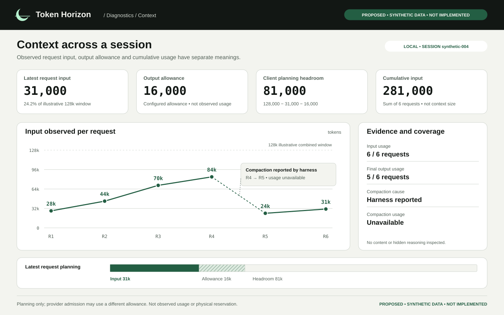
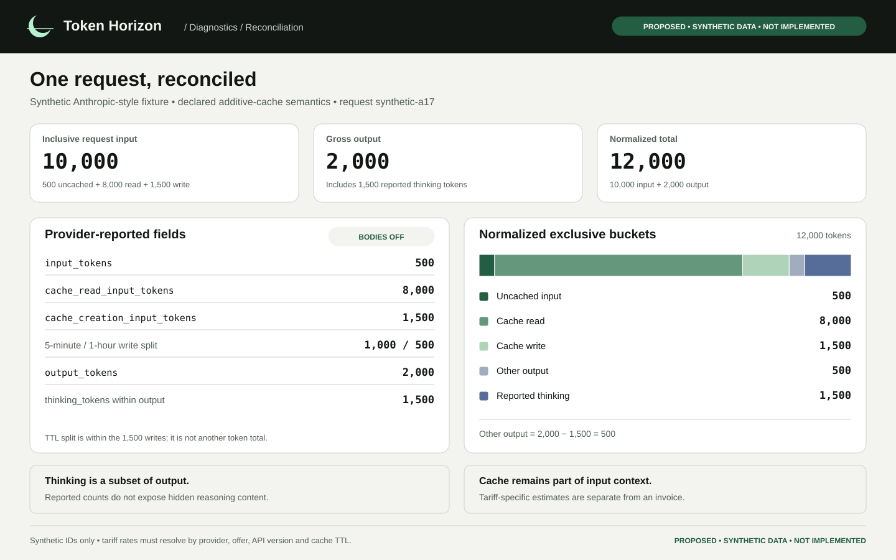
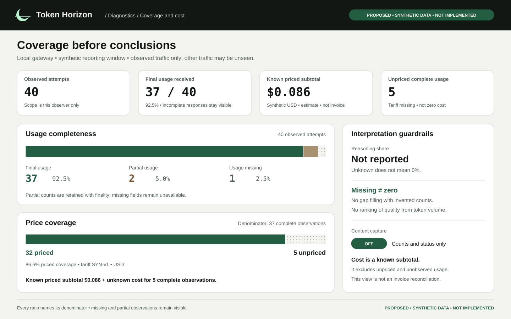

# Token Horizon — Track 6: Token and Context Analytics

**Research and implementation specification · 18 November 2026 · Regular Pro Chat**  
**Status: source audit and original proposals. No application changes, live instrumentation, deployment, or production validation.**

Repository: [castlemilk/token-horizon](https://github.com/castlemilk/token-horizon)  
Pinned branch: **main**  
Pinned commit: **b468206e9378c8d7a6788b67072494982e7de17d**  
Commit timestamp: **2026-11-18 07:35:19 UTC** / **18:35:19 Australia/Melbourne**  
Commit subject: `catalog: refresh model list (2026-11-18)`  
Public product identified from the repository README: **[token-horizon.dev](https://token-horizon.dev/)**.

## 1. Decision and priorities

**Build a shared, evidence-preserving accounting contract before making context occupancy a headline metric.** The repository already contains useful capture, trace, catalog, sync and provenance foundations. The first opportunity is to make those foundations agree across Swift, the standalone gateway and the Go daemon. A polished context chart built directly on the current aggregate counters could display a precise-looking answer to a different question.

The highest-value sequence is:

1. **Correct and version normalization.** Preserve provider/API-specific inclusion rules, missing fields and stream finality. Fix the Swift Codex total, native trace pricing, Anthropic stream/cache handling and denominator errors before deriving more metrics.
2. **Align privacy defaults and preserve trace evidence.** The standalone gateway defaults to metadata-only body capture; the Go daemon's absent trace-capture setting enables full bodies. Make content-free collection the consistent baseline, with separate explicit body-capture consent. Bring completion and coverage fields through to the native UI.
3. **Reconcile observations and tariffs.** Deduplicate multiple observations of one attempt without deleting genuine retry usage. Reuse existing price-interval schema/query support and snapshot-sync work; add precise tariff identity and presence-aware pricing.
4. **Add context observations and diagnostic views.** Distinguish the latest assembled/accepted context from cumulative processing, record explicit compaction/truncation events, and count tool/retrieval insertion at the harness boundary.
5. **Expand adapters only behind capability evidence.** API families, model versions, runtime settings and provider transports need independent contracts. “OpenAI-compatible” is a routing description, not a universal accounting guarantee.

These are feasibility judgments based on source structure, not measured demand, customer incidents or a market-size study. Track 1 owns market validation. All effort estimates below are provisional engineering estimates.

### Evidence labels used throughout

| Label | Meaning in this report |
|---|---|
| **Current public surface** | Text or published catalog metadata retrieved from the public product during this study. It does not prove the deployed binary or backend commit. |
| **Source-only** | Behavior visible at the pinned repository revision. It may be reachable in a build; it is not evidence that an installed client exercised it. |
| **Measured synthetic** | An isolated local experiment with invented numeric records. The exact experiment and limitations are supplied. |
| **Inferred** | A consequence reasoned from source or documented semantics. Impact on real users remains unmeasured. |
| **Proposed** | A design, backlog item, acceptance condition or wireframe. It is not implemented UI or tested production behavior. |

## 2. Inspection scope, provenance and access gaps

### 2.1 What was inspected

The connected GitHub read tools returned the repository metadata, `main` branch head and complete recursive tree: **2,031 entries, not truncated**, tree SHA `6de51943395eb99558045ee69a848bb5d63bec57`. The source audit followed the actual data paths before designing analytics: Swift usage/parsing and native traces; the standalone Go gateway; Go daemon event models, meter/file capture, SQLite queries and retention; model catalog/export; and the existing sync contract. File/blob identifiers are listed in `evidence-manifest.json`. No shared checkout was edited.

The issue audit read both all-state Issues API pages, the all-state PR collection, relevant issue bodies and selected comments. At inspection there were **31 ordinary issues, all open**, and **15 PRs: 12 merged, two open drafts and one closed unmerged**. The Issues API's 46 combined records must not be mistaken for 46 feature issues. There were no closed ordinary issues in the retrieved collection. The inventory is included as `issue-inventory.json`; records may change after this snapshot. [I1](https://api.github.com/repos/castlemilk/token-horizon/issues?state=all&per_page=100&page=1)

The current public landing page and documentation describe local usage/cost tracking, an optional gateway, opt-in publication and sample/illustrative dashboard data. The product URL is grounded in the repository README, not inferred from a similar name. The `/models` page returned a page shell; its interactive catalog was not visually exercised. A successful read-only public catalog search returned a catalog count of **2,074** and `generated_at=1793821960`, or **2026-11-04 19:52:40 UTC**. This is a measured response field, not proof that all product data are stale. Main's 18 November catalog commit and a published catalog's generation time are distinct evidence; existing issue [#41](https://github.com/castlemilk/token-horizon/issues/41) owns publication lineage. [P1](https://token-horizon.dev/) [P2](https://token-horizon.dev/docs/) [P3](evidence-manifest.json) [I8](https://github.com/castlemilk/token-horizon/issues/41)

Official provider documentation was read on **18 November 2026**. “Retrieved” is not a claim about an undocumented publication date. Current docs contain semantics newer than common historical assumptions, including OpenAI cache-write categories, Claude compaction iterations and Gemini tool-use prompt counters. Those contracts must be versioned rather than baked into a provider-name switch. [D1](https://developers.openai.com/api/docs/guides/prompt-caching) [D2](https://developers.openai.com/api/reference/resources/responses/methods/create) [D3](https://developers.openai.com/api/reference/resources/chat/subresources/completions/methods/create) [D4](https://platform.claude.com/docs/en/build-with-claude/prompt-caching) [D5](https://platform.claude.com/docs/en/api/typescript/messages) [D6](https://platform.claude.com/docs/en/build-with-claude/streaming.md) [D7](https://platform.claude.com/docs/en/build-with-claude/compaction-on-demand) [D8](https://aistudio.google.com/api-reference/generate-content) [D9](https://aistudio.google.com/api-reference/interactions-api) [D10](https://docs.ollama.com/api/usage) [D11](https://docs.ollama.com/api/chat) [D12](https://api-docs.deepseek.com/api/create-chat-completion/) [D13](https://docs.x.ai/developers/advanced-api-usage/prompt-caching/usage-and-pricing) [D14](https://developers.openai.com/api/docs/guides/reasoning)

### 2.2 What was not established

- No installed desktop client, local daemon, private session, real prompt, raw trace, personal usage history or invoice was accessed.
- No authenticated private product dashboard or rendered desktop/browser interaction was tested. Public text retrieval and a public catalog connector read do not establish end-to-end UX correctness.
- `/api/health` and `/blog/pricing-evidence` could not be retrieved by the research web tool. That is an access/retrieval gap, not a finding that the service is down or access is denied.
- The public product's deployed commit, release identifier, live migration state and actual user exposure to source defects remain unverified. A merged PR does not establish deployment.
- Linked prior ChatGPT research conversations/pages were not independently opened. GitHub issue text was treated as project context; linked claims were not invented.
- No usable Go or Swift toolchain was available for application builds. Native and repository test suites were not run. Broad default MCP tests were deliberately not used because [#39](https://github.com/castlemilk/token-horizon/issues/39) records live-service/conditional publication behavior. The isolated tests here have no network or application imports. [I9](https://github.com/castlemilk/token-horizon/issues/39)
- No real API inference, paid service, account/configuration change, third-party contact, issue/PR creation, merge, publication or deployment occurred.

## 3. Actual data paths and useful existing foundations

| Source path at the pin | Observed current structure | Consequence for Track 6 |
|---|---|---|
| `clients/macos/.../Usage/UsageEngine.swift`, `Models.swift` | Local log parsing, Codex cumulative watermarks, five token categories, aggregate model/day usage; generic character-based fallback exists. | Preserve legacy ingest while making category semantics and estimates explicit. Aggregate history cannot reconstruct unavailable per-request identities. [S1](https://github.com/castlemilk/token-horizon/blob/b468206e9378c8d7a6788b67072494982e7de17d/clients/macos/Sources/TokenHorizon/Usage/UsageEngine.swift) [S2](https://github.com/castlemilk/token-horizon/blob/b468206e9378c8d7a6788b67072494982e7de17d/clients/macos/Sources/TokenHorizon/Usage/Models.swift) [S3](https://github.com/castlemilk/token-horizon/blob/b468206e9378c8d7a6788b67072494982e7de17d/clients/macos/Tests/TokenHorizonPerfTests/Unit/JsonlParserTests.swift) |
| `gateway/usage.go`, `trace.go`, `stream_metadata.go`, `proxy.go` | Provider parsers; nullable numeric trace fields; bounded full-stream metadata observer; requested/returned model and provider IDs; completion/usage coverage; body capture opt-in. | Extend this evidence path. Do not rebuild it as if full-stream observation or partial-stream handling were missing. [S4](https://github.com/castlemilk/token-horizon/blob/b468206e9378c8d7a6788b67072494982e7de17d/gateway/usage.go) [S5](https://github.com/castlemilk/token-horizon/blob/b468206e9378c8d7a6788b67072494982e7de17d/gateway/trace.go) [S6](https://github.com/castlemilk/token-horizon/blob/b468206e9378c8d7a6788b67072494982e7de17d/gateway/stream_metadata.go) [S7](https://github.com/castlemilk/token-horizon/blob/b468206e9378c8d7a6788b67072494982e7de17d/gateway/proxy.go) [S8](https://github.com/castlemilk/token-horizon/blob/b468206e9378c8d7a6788b67072494982e7de17d/gateway/config.go) |
| `clients/macos/.../Gateway/TraceModels.swift`, `TraceStore.swift`, `UI/TracesViews.swift` | Native trace decoding, read-time catalog pricing and trace UI. Some newer gateway evidence does not survive the native DTO. | Decode and render the existing evidence before adding diagnostic charts. [S9](https://github.com/castlemilk/token-horizon/blob/b468206e9378c8d7a6788b67072494982e7de17d/clients/macos/Sources/TokenHorizon/Gateway/TraceModels.swift) [S10](https://github.com/castlemilk/token-horizon/blob/b468206e9378c8d7a6788b67072494982e7de17d/clients/macos/Sources/TokenHorizon/Gateway/TraceStore.swift) [S11](https://github.com/castlemilk/token-horizon/blob/b468206e9378c8d7a6788b67072494982e7de17d/clients/macos/Sources/TokenHorizon/UI/TracesViews.swift) |
| `daemons/go/internal/usage/types.go`, `usageparse.go` | Stored token breakdown deliberately uses exclusive/net buckets; event has nullable context/session fields but numeric token/cost defaults. | Introduce a versioned observation envelope; do not silently redefine stored `input`/`output`. [S12](https://github.com/castlemilk/token-horizon/blob/b468206e9378c8d7a6788b67072494982e7de17d/daemons/go/internal/usage/types.go) [S13](https://github.com/castlemilk/token-horizon/blob/b468206e9378c8d7a6788b67072494982e7de17d/daemons/go/internal/usage/usageparse.go) |
| `daemons/go/internal/capture/meter`, `capture/files` | Meter/file methodologies, file annotations, request IDs and cumulative import paths. Meter constructs an input-derived context value but not a complete context/session model. | Prefer exact observation identity and optional harness events. File bucket imports need an honest aggregate-only status. [S14](https://github.com/castlemilk/token-horizon/blob/b468206e9378c8d7a6788b67072494982e7de17d/daemons/go/internal/capture/meter/meter.go) [S15](https://github.com/castlemilk/token-horizon/blob/b468206e9378c8d7a6788b67072494982e7de17d/daemons/go/internal/capture/files/codex.go) [S16](https://github.com/castlemilk/token-horizon/blob/b468206e9378c8d7a6788b67072494982e7de17d/daemons/go/internal/capture/files/backfill.go) |
| `daemons/go/internal/store`, `providers/catalog` | SQLite events and annotations; price table with `valid_from`; effective cost/product precedence; aggregate queries. | Extend existing tariff-schema support, verify its ingestion path and correct joins/denominators; avoid a parallel inconsistent ledger. [S17](https://github.com/castlemilk/token-horizon/blob/b468206e9378c8d7a6788b67072494982e7de17d/daemons/go/internal/store/query.go) [S18](https://github.com/castlemilk/token-horizon/blob/b468206e9378c8d7a6788b67072494982e7de17d/daemons/go/internal/store/schema.go) [S19](https://github.com/castlemilk/token-horizon/blob/b468206e9378c8d7a6788b67072494982e7de17d/daemons/go/internal/providers/catalog/catalog.go) [S20](https://github.com/castlemilk/token-horizon/blob/b468206e9378c8d7a6788b67072494982e7de17d/daemons/go/internal/platform/config.go) |
| `docs/sync-consistency.md` | Dated bucket snapshots, replacement/idempotence, original timestamps, newer downward correction, ownership and ETag conflict checks. | Preserve these guarantees when normalized values are restated. Sync time must never become usage time. [S21](https://github.com/castlemilk/token-horizon/blob/b468206e9378c8d7a6788b67072494982e7de17d/docs/sync-consistency.md) |

Closed work provides important regression boundaries. **PR [#4](https://github.com/castlemilk/token-horizon/pull/4)**, merged **7 October 2026**, introduced reliable full-stream metadata traces, optional bodies and completion/coverage fields. **PR [#5](https://github.com/castlemilk/token-horizon/pull/5)**, merged the same day, added estimate/invoice provenance labels to MCP presentation. **PR [#7](https://github.com/castlemilk/token-horizon/pull/7)** clarified that a hosted plan's model `limit` is a model count, not a context limit. **PR [#8](https://github.com/castlemilk/token-horizon/pull/8)** established managed ownership boundaries; **PR [#11](https://github.com/castlemilk/token-horizon/pull/11)** hardened refresh rotation. **PR [#17](https://github.com/castlemilk/token-horizon/pull/17)**, merged **11 November**, separated task/scorer benchmarks from activity. Reuse these decisions; this study does not assert they are absent. [I10](https://github.com/castlemilk/token-horizon/pull/4) [I11](https://github.com/castlemilk/token-horizon/pull/5) [I12](https://github.com/castlemilk/token-horizon/pull/7) [I13](https://github.com/castlemilk/token-horizon/pull/8) [I14](https://github.com/castlemilk/token-horizon/pull/11) [I15](https://github.com/castlemilk/token-horizon/pull/17)

## 4. Concrete findings and impact limits

### F1 — Swift Codex totals include subsets twice — P0

**Source-only:** `CodexWatermark.total` at `UsageEngine.swift:243–250` adds `input + output + cached + reasoning`. The parser maps Codex's inclusive input/output and their cache/reasoning subsets into these fields. The Go Codex path instead takes the gross input/output delta and subtracts subsets into exclusive storage. [S1](https://github.com/castlemilk/token-horizon/blob/b468206e9378c8d7a6788b67072494982e7de17d/clients/macos/Sources/TokenHorizon/Usage/UsageEngine.swift) [S15](https://github.com/castlemilk/token-horizon/blob/b468206e9378c8d7a6788b67072494982e7de17d/daemons/go/internal/capture/files/codex.go)

The official Codex producer was independently inspected at `openai/codex` commit **24e236514bebcef874c2d38ce5df26164aa50ca4**, timestamp **2026-11-18 07:43:45 UTC**. Its Responses mapping preserves inclusive input/output plus separate cached/write/reasoning fields; its protocol also provides response/turn/thread/session IDs and a `model_context_window`. This supports the inclusion-rule finding without access to any personal logs. The upstream producer revision is evidence of that producer contract, not proof of the version installed by a Token Horizon user. [C1](https://github.com/openai/codex/blob/24e236514bebcef874c2d38ce5df26164aa50ca4/codex-rs/codex-api/src/sse/responses.rs) [C2](https://github.com/openai/codex/blob/24e236514bebcef874c2d38ce5df26164aa50ca4/codex-rs/protocol/src/protocol.rs)

**Synthetic consequence:** input 1,000, output 200, cache-read 800 and reasoning 50 should total 1,200 under that contract; the Swift expression yields 2,050. This is an arithmetic demonstration, not a measured user's overcount. Correct the producer-specific normalization and migration before reinterpreting historical totals. Legacy records without raw fields must remain explicitly unrecoverable rather than being proportionally “fixed.”

### F2 — Generic Swift fallback can count OpenAI-shaped usage twice — P0/P1

**Source-only:** `parseAdditiveObject` invokes multiple extractors. `geminiBreakdown` also accepts `prompt_tokens` and `completion_tokens`, so an OpenAI-shaped usage object can match both paths. `JsonlParserTests.swift:30–48,70–76` explicitly encodes this as a known dormant quirk: prompt 30/output 40 becomes input 60/output 80. The test comment says no scanned home currently emits that shape; deployment reachability is unverified. [S1](https://github.com/castlemilk/token-horizon/blob/b468206e9378c8d7a6788b67072494982e7de17d/clients/macos/Sources/TokenHorizon/Usage/UsageEngine.swift) [S3](https://github.com/castlemilk/token-horizon/blob/b468206e9378c8d7a6788b67072494982e7de17d/clients/macos/Tests/TokenHorizonPerfTests/Unit/JsonlParserTests.swift)

Replace overlapping shape guesses with a selected, versioned provider/API/log-format adapter. Retain unknown numeric objects for diagnosis only through an allowlist; do not “try all parsers and sum.” Mark the existing characters-divided-by-four fallback as an estimate with method revision, or remove it from reported-only totals. It must not masquerade as provider usage.

### F3 — Anthropic gateway arithmetic misses categories and can add cumulative snapshots — P0

**Source-only:** `gateway/usage.go:245–295` keeps raw `input_tokens` and cache-read separately, omits cache creation, and adds output values across supplied objects. The live stream metadata observer already replaces repeated `message_delta` frames, so a claim that every delta is always double-counted would be too broad. However, the retained `message_start` output and final cumulative output are still additive. The current regression fixture starts at zero; an initial 1 followed by final 85 produces 86 through that expression. [S4](https://github.com/castlemilk/token-horizon/blob/b468206e9378c8d7a6788b67072494982e7de17d/gateway/usage.go) [S6](https://github.com/castlemilk/token-horizon/blob/b468206e9378c8d7a6788b67072494982e7de17d/gateway/stream_metadata.go)

Use the latest present cumulative value per field and retain starting input/cache values when later frames omit them. For ordinary Messages usage, normalize disjoint uncached/read/write input categories. Recognize current `thinking_tokens` evidence and separately version compaction iteration accounting. Missing final frames remain partial/unknown. [D4](https://platform.claude.com/docs/en/build-with-claude/prompt-caching) [D5](https://platform.claude.com/docs/en/api/typescript/messages) [D6](https://platform.claude.com/docs/en/build-with-claude/streaming.md) [D7](https://platform.claude.com/docs/en/build-with-claude/compaction-on-demand)

### F4 — Evidence exists in the gateway but is lost or shown as zero in the native UI — P0

**Source-only:** the gateway Trace includes `requestedModel`, `providerResponseId`, `completionState`, `usageCoverage` and `captureMode`; the inspected Swift `GatewayTrace` omits them. The native list uses `inputTokens ?? 0` and `outputTokens ?? 0`, while the detail view can show a dash. Aggregate cards also collapse unavailable quantities to zero. [S5](https://github.com/castlemilk/token-horizon/blob/b468206e9378c8d7a6788b67072494982e7de17d/gateway/trace.go) [S9](https://github.com/castlemilk/token-horizon/blob/b468206e9378c8d7a6788b67072494982e7de17d/clients/macos/Sources/TokenHorizon/Gateway/TraceModels.swift) [S11](https://github.com/castlemilk/token-horizon/blob/b468206e9378c8d7a6788b67072494982e7de17d/clients/macos/Sources/TokenHorizon/UI/TracesViews.swift)

A missing usage field is not evidence of no consumption. Carry field presence and finality through decoding, aggregation and export. A known subtotal can be shown, accompanied by its coverage and excluded unknown observations. Do not silently backfill zeros from old DTOs.

### F5 — Cost calculation and price provenance differ by path — P0

**Source-only:** native `TraceStore.swift:91–99` prices inclusive input, output and cached input as three additive terms. For APIs where cache-read is a subset of input, cached tokens are therefore priced once at the normal input rate and again at the cached rate. Swift's generic cost estimator uses substring-based fallback rates and generic cache multipliers; unknown models can return zero. The daemon schema and read queries support time-versioned pricing intervals; this audit did not identify their production population or establish installed use. Its equivalent-price SQL charges writes as ordinary input and can treat an unavailable cache rate as zero. [S10](https://github.com/castlemilk/token-horizon/blob/b468206e9378c8d7a6788b67072494982e7de17d/clients/macos/Sources/TokenHorizon/Gateway/TraceStore.swift) [S1](https://github.com/castlemilk/token-horizon/blob/b468206e9378c8d7a6788b67072494982e7de17d/clients/macos/Sources/TokenHorizon/Usage/UsageEngine.swift) [S17](https://github.com/castlemilk/token-horizon/blob/b468206e9378c8d7a6788b67072494982e7de17d/daemons/go/internal/store/query.go) [S18](https://github.com/castlemilk/token-horizon/blob/b468206e9378c8d7a6788b67072494982e7de17d/daemons/go/internal/store/schema.go) [S19](https://github.com/castlemilk/token-horizon/blob/b468206e9378c8d7a6788b67072494982e7de17d/daemons/go/internal/providers/catalog/catalog.go)

**Synthetic cost example:** with input 1,000 including cache-read 800, output 200, and invented rates of $2/$0.20/$8 per million ordinary-input/cache-read/output tokens, correct estimated cost is **$0.00216**. The native additive expression gives **$0.00376**. These are test prices, not current market tariffs or an invoice discrepancy. Price mutually exclusive categories under an exact tariff revision; leave unresolved amounts unpriced.

### F6 — Go analytic queries have reproducible denominator and join defects — P0

**Measured synthetic:** `daemon_sql_probe.py` runs extracted source SQL expressions against an in-memory SQLite database containing invented records. It is not a daemon execution. Results are supplied in `daemon-sql-synthetic-results.json`. [S17](https://github.com/castlemilk/token-horizon/blob/b468206e9378c8d7a6788b67072494982e7de17d/daemons/go/internal/store/query.go)

| Isolated condition | Reproduced source-expression result | Required behavior |
|---|---|---|
| Equal-weight rows: one reports generation rate 10, one is missing | Average 5 | Known-only average 10, coverage 1/2 |
| Equal-weight rows: one context value 100, one missing | Average 50 | Known-only average 100, coverage 1/2; do not call it a current occupancy gauge |
| Two vendors reuse a request ID; annotation has no vendor constraint | Foreign-vendor annotation joins; effective event cost 2 while aggregate raw cost is 0 | Scope identity and use one declared cost basis in detail and rollup |
| Product filter applied to a bucket query without the annotation alias join | SQLite error `no such column: fa.product` | Filter and aggregate use a consistent authorized effective projection |

This proves the behavior of the copied SQL with synthetic inputs, not prevalence in deployed data. It is a narrow, actionable regression target before adding team/context aggregates.

### F7 — Content capture defaults are inconsistent — P0

**Source-only:** the standalone gateway enables bodies only with the explicit body-capture configuration. The daemon's `Settings.TraceCaptureEnabled()` returns true when the setting and environment override are absent; full bodies are bounded per side but body retention is not the same as content-free telemetry. Metering consent is required for relay use, yet it is not a distinct explicit body-capture choice in this path. [S7](https://github.com/castlemilk/token-horizon/blob/b468206e9378c8d7a6788b67072494982e7de17d/gateway/proxy.go) [S8](https://github.com/castlemilk/token-horizon/blob/b468206e9378c8d7a6788b67072494982e7de17d/gateway/config.go) [S14](https://github.com/castlemilk/token-horizon/blob/b468206e9378c8d7a6788b67072494982e7de17d/daemons/go/internal/capture/meter/meter.go) [S20](https://github.com/castlemilk/token-horizon/blob/b468206e9378c8d7a6788b67072494982e7de17d/daemons/go/internal/platform/config.go)

Make content-free collection the default across both paths. Existing installations need a visible effective-state explanation, a separate body-capture opt-in and an explicit deletion/expiry path. Do not silently reinterpret historical consent, delete existing records, or claim that this source observation proves any actual user's prompts were collected. This study inspected no such records.

### F8 — Current context fields do not establish conversation occupancy — P1

**Source-only:** daemon Event defines nullable context/session fields, but meter `buildEvent` derives a context quantity from request input and does not populate a complete limit/session lineage. Gateway parsing can use `previous_response_id` or Anthropic `metadata.user_id` as session hints: a parent response or a user is not a stable conversation identity. Swift model `contextK` is catalog capacity, not an observed retained-context measurement. [S2](https://github.com/castlemilk/token-horizon/blob/b468206e9378c8d7a6788b67072494982e7de17d/clients/macos/Sources/TokenHorizon/Usage/Models.swift) [S4](https://github.com/castlemilk/token-horizon/blob/b468206e9378c8d7a6788b67072494982e7de17d/gateway/usage.go) [S12](https://github.com/castlemilk/token-horizon/blob/b468206e9378c8d7a6788b67072494982e7de17d/daemons/go/internal/usage/types.go) [S14](https://github.com/castlemilk/token-horizon/blob/b468206e9378c8d7a6788b67072494982e7de17d/daemons/go/internal/capture/meter/meter.go)

The missing layer is an explicit observation of a particular context stage and its compatible limit. Aggregate input work, request-body bytes and catalog capacity are insufficient to reconstruct provider-retained state. Show unknown attribution and raw measured scope until a harness/provider contract supplies the necessary evidence.

### F9 — Instrumentation coverage and timing need exact names — P1

**Source-only:** gateway `ttftMs` is measured at the first response body bytes, which may be metadata; it is not necessarily first generated text/token. The Go meter uses a bounded whole-response buffer; oversized responses can be forwarded without complete usage capture, and disconnect/read-error finalization differs from the standalone gateway. The gateway's bounded observer is a useful pattern to share. [S7](https://github.com/castlemilk/token-horizon/blob/b468206e9378c8d7a6788b67072494982e7de17d/gateway/proxy.go) [S14](https://github.com/castlemilk/token-horizon/blob/b468206e9378c8d7a6788b67072494982e7de17d/daemons/go/internal/capture/meter/meter.go)

Name byte timing as such. Use a distinct nullable first-generated-content timestamp only where a provider event contract supports it. Report parser overflow, observer drops and interrupted accounting. Neither zero final usage nor estimated duration should be manufactured to fill gaps. Transport completion and accounting completeness are separate facts.

### F10 — Modern provider fields and live catalog lineage need explicit capabilities — P1

**Source-only plus current documentation:** current adapters do not fully model OpenAI Responses cache writes/TTL, Claude compaction iterations, Gemini tool-use prompt work, or Ollama's cached prompt count. Gemini total-only fallback can assign a total to input, which must not become fake context evidence. [S4](https://github.com/castlemilk/token-horizon/blob/b468206e9378c8d7a6788b67072494982e7de17d/gateway/usage.go) [S13](https://github.com/castlemilk/token-horizon/blob/b468206e9378c8d7a6788b67072494982e7de17d/daemons/go/internal/usage/usageparse.go) [D1](https://developers.openai.com/api/docs/guides/prompt-caching) [D2](https://developers.openai.com/api/reference/resources/responses/methods/create) [D3](https://developers.openai.com/api/reference/resources/chat/subresources/completions/methods/create) [D4](https://platform.claude.com/docs/en/build-with-claude/prompt-caching) [D5](https://platform.claude.com/docs/en/api/typescript/messages) [D6](https://platform.claude.com/docs/en/build-with-claude/streaming.md) [D7](https://platform.claude.com/docs/en/build-with-claude/compaction-on-demand) [D8](https://aistudio.google.com/api-reference/generate-content) [D9](https://aistudio.google.com/api-reference/interactions-api) [D10](https://docs.ollama.com/api/usage) [D11](https://docs.ollama.com/api/chat)

The native Ollama gateway parser also requires a positive evaluation duration before accepting native token counts; usage availability should be independent of whether a speed denominator is available. Treat these as adapter capability gaps. The read-only public catalog response also demonstrates why catalog generation, source commit, deployment and tariff-effective timestamps need separate fields. Existing [#12](https://github.com/castlemilk/token-horizon/issues/12) THR-09/20, [#19](https://github.com/castlemilk/token-horizon/issues/19) and [#41](https://github.com/castlemilk/token-horizon/issues/41) are the appropriate dependencies. [I2](https://github.com/castlemilk/token-horizon/issues/12) [I7](https://github.com/castlemilk/token-horizon/issues/19) [I8](https://github.com/castlemilk/token-horizon/issues/41)

## 5. Provider semantics and capability matrix

### 5.1 A common vocabulary, with provider-specific mappings

Use `I` for inclusive input work, `O` for inclusive generated output, `U` for ordinary uncached input, `R` for cache-read input, `W` for cache-write input and `Q` for a reported reasoning/thinking category. “Inclusive” and “exclusive” are part of the field contract, not optional display prose.

For an adapter whose verified contract is `I = U + R + W` and `Q` is included in `O`, the processed total is **`I + O`**, equivalently **`U + R + W + (O − Q) + Q`**. Adding `R`, `W` or `Q` to already inclusive parent totals counts the same units again. Some providers expose different partitions, internal iterations, modality units or server tools; preserve those differences instead of forcing every response into that equation.

A reported reasoning count does not reveal hidden reasoning, its correctness, the visible explanation's length or task quality. “Other output” is a numeric remainder under a known contract, not necessarily visible prose. Model/API-specific retention rules govern whether any earlier reasoning remains in later context. Token counts must never become a productivity, intelligence or answer-quality score.

### 5.2 Current official contracts and source coverage

All documentation rows were inspected on 18 November 2026. Support is per API/version/model/transport, not a claim that every account has the feature. “Absent” remains unknown unless the relevant version contract explicitly defines absence as a semantic zero; producer-defaulted zero and provider-reported zero should retain different provenance.

| Provider/API family | Verified mapping and important limit | Current Token Horizon gap / proposed handling |
|---|---|---|
| **OpenAI Responses** | `input_tokens`/`output_tokens` are inclusive. Cached input and reasoning are subsets. Current GPT-5.6+ cache accounting includes disjoint `cache_write_tokens`, subdivided into 30-minute/12-hour writes; ordinary input excludes both read and write. [D1](https://developers.openai.com/api/docs/guides/prompt-caching) [D2](https://developers.openai.com/api/reference/resources/responses/methods/create) | Gateway/Swift/daemon need API-versioned write/TTL handling. Retain returned model and response identity; do not project these write fields onto older APIs. |
| **OpenAI Chat Completions** | `prompt_tokens`/`completion_tokens` are inclusive; nested cached/reasoning detail is not additive. Stream usage can arrive in a final usage chunk; interruption can prevent that chunk. [D3](https://developers.openai.com/api/reference/resources/chat/subresources/completions/methods/create) | Missing final usage is unknown/partial. Do not silently alter client requests to request usage. Test null, absent and explicit zero independently. |
| **Claude Messages** | Raw `input_tokens` is uncached input; read and creation counts are additional input categories. Write TTL has 5-minute/1-hour subdivisions. Current thinking count is a subset of output and may differ slightly from exact internal generation. Stream usage deltas are cumulative. [D4](https://platform.claude.com/docs/en/build-with-claude/prompt-caching) [D5](https://platform.claude.com/docs/en/api/typescript/messages) [D6](https://platform.claude.com/docs/en/build-with-claude/streaming.md) | Normalize input before cache ratios/context proxies; preserve TTL and approximate reasoning semantics; merge cumulative fields rather than sum snapshots. |
| **Claude on-demand compaction** | Current beta `compact-2026-09-04` puts billable compaction work in `usage.iterations`; top-level input/output may be zero. [D7](https://platform.claude.com/docs/en/build-with-claude/compaction-on-demand) | Select the documented accounting level. Link a compaction operation to the context transition; never add parent summaries and their children. |
| **Gemini GenerateContent** | Prompt includes cached content. Current total covers prompt, tool-use prompt, thoughts and candidates. Preserve those four components; cache and modality details are overlapping views, not extra totals. [D8](https://aistudio.google.com/api-reference/generate-content) | Keep `promptTokenCount` separate from all input work. Add `toolUsePromptTokenCount`; never turn a total-only response into known input. Validate the reported-total residual. |
| **Gemini Interactions** | A distinct event/usage contract, including cumulative workflow/step reporting and per-step usage. It is not simply GenerateContent with new names. [D9](https://aistudio.google.com/api-reference/interactions-api) | Separate adapter and accounting scope. Do not add cumulative workflow usage to already counted steps. Mark unimplemented in the capability registry. |
| **Ollama native** | Final usage exposes prompt/evaluation counts and current `prompt_eval_cached_count`; timing units are nanoseconds. Numeric reasoning subdivision was not established here. [D10](https://docs.ollama.com/api/usage) [D11](https://docs.ollama.com/api/chat) | Read cached count when supported, preserve unknown reasoning and runtime revision. Effective context needs configured runtime evidence; catalog maximum alone is insufficient. |
| **DeepSeek Chat** | Prompt cache hit/miss partition prompt tokens; completion reasoning detail is an output subset. Compatible field names do not erase provider-specific cache/tool billing. [D12](https://api-docs.deepseek.com/api/create-chat-completion/) | Register a verified DeepSeek contract rather than only the generic OpenAI shape; distinguish server-tool units from token categories. |
| **xAI Chat/Responses** | Official cache-usage documentation describes inclusive input/output with cached/reasoning details. API shape and model are part of the contract. [D13](https://docs.x.ai/developers/advanced-api-usage/prompt-caching/usage-and-pricing) | Use its documented field mapping and exact offer/tariff, with observed field coverage. Do not infer unreported cache-write or reasoning values. |
| **Other routed compatible providers / local engines** | No exhaustive current official contract audit was completed for every routed backend. | Mark individually unverified/partial, not supported-by-assumption. Kimi, GLM, MiniMax, Qwen, additional cloud platforms, Realtime/WebSocket and specialized media APIs require their own evidence. |

**OpenAI conversation/compaction scope:** server-side continuation can include prior input beyond the latest wire body; do not estimate context from request bytes or assume a parent response ID represents a whole session. The separate compact operation has its own usage contract and belongs in the ledger at its documented scope. [D18](https://developers.openai.com/api/docs/guides/conversation-state) [D19](https://developers.openai.com/api/reference/resources/responses/methods/compact)

**Cache pricing detail:** current OpenAI documentation describes 30-minute and 12-hour write rates as 1.25× and 2.5× ordinary input respectively; these are complete category rates, not an extra surcharge added after ordinary input. Keep these facts inside the model/API tariff capability, not a global multiplier. Claude's distinct TTL structure needs its own tariff keys. [D1](https://developers.openai.com/api/docs/guides/prompt-caching) [D4](https://platform.claude.com/docs/en/build-with-claude/prompt-caching)

### 5.3 Model limits: typed evidence rather than one integer

Representative official limits were checked to demonstrate the required schema; this is not a model recommendation or a timeless compatibility table.

| Official model page inspected | Documented input/context and output values | Required product interpretation |
|---|---|---|
| OpenAI `gpt-5.4` | Context 1,050,000; maximum output 128,000. The page identifies snapshot `gpt-5.4-2026-03-05`. [D15](https://developers.openai.com/api/docs/models/gpt-5.4) | Store model/snapshot and the provider's window semantics. Requested output allowance is separate from observed output. |
| Claude `claude-sonnet-4-6` | 1M context; 128K maximum output, preserving the notation displayed by the retrieved overview. [D16](https://platform.claude.com/docs/en/models/sonnet-4-6/overview) | Verify applicable platform/API/model conditions and retained-thinking rules before deriving headroom. |
| Gemini `gemini-3.8-flash` | Maximum input 1,048,576; maximum output 65,536. [D17](https://aistudio.google.com/docs/models/gemini-3.8-flash) | Preserve distinct input/output limits; do not subtract output allowance from an independent input limit. |
| Local model/runtime | No universal limit value applies. | Store advertised model limit and separately observed `num_ctx`/runtime configuration, serving revision and evidence time. Use the effective applicable limit only when established. [D10](https://docs.ollama.com/api/usage) [I5](https://github.com/castlemilk/token-horizon/issues/15) |

Do not use hosted plan `limit` as token capacity. A requested alias can resolve to a different model; preserve both. Where the applicable model, stage, tokenizer or limit semantics are unknown, show the count and “limit unavailable,” without an exact occupancy percentage. A stale catalog fact may be displayed as advertised evidence with its timestamp, not silently promoted to a current runtime measurement.

## 6. Proposed measurement contract

### 6.1 Preserve observations; version interpretations

Add a **UsageObservationV2 envelope** alongside the legacy DTO. Keep the existing Go five-bucket net/exclusive meaning until an explicit migration converts consumers. A new inclusive field named `input_tokens` must not silently overwrite a legacy field named `input` with different semantics.

The envelope has five parts:

| Part | Proposed fields and rules |
|---|---|
| Identity | Schema/adapter/normalization revision; observation ID; source sequence; authenticated tenant and billing-account namespace; provider/API/transport; attempt and provider response/request IDs when available. |
| Time and state | Original observation/start/end timestamps; received time; event ordering; completion state; usage finality; correction/replacement relationship. Clock source and uncertainty are explicit. |
| Usage evidence | Numeric allowlisted source fields with presence and provenance; inclusive input/output where derivable; exclusive components; reported total; derived total and reconciliation residual. |
| Model/configuration | Requested alias, returned/resolved model, model snapshot when known, harness/runtime version, config revision, capability revision, requested output cap, provider admission allowance/limit and limit/tariff references. |
| Attribution | Optional conversation/session, branch, turn, parent attempt and accounting iteration IDs; attribution method and confidence class. Unknown is allowed. |

Do not store an arbitrary provider JSON `usage` object merely because it normally contains counters. Only reviewed numeric paths and bounded enumerations enter the content-free ledger. Unknown fields produce a schema-observation counter or safe field-name diagnostic after allowlist review; they do not create a payload escape hatch.

Each token-count field carries:

- `value`: nonnegative integer or null; zero is a real value only with evidence.
- `evidence`: `provider_reported`, `source_reported`, `locally_counted`, `derived`, `estimated`, `unavailable`, `unsupported`, `withheld` or `invalid`.
- `completeness`: `final`, `partial`, `lower_bound`, `unknown` or `not_applicable`, with the exact scope it describes.
- `source_field`, `method_revision`, `inclusion_rule`, `observed_at`, and an optional reason code such as `final_frame_missing` or `parser_limit`.

Derived differences and planning headroom may be signed; money uses explicit decimal units. These are separate types from nonnegative token counts.

Use `derived` only when every required operand and inclusion rule is known. A provider-reported figure can itself be approximate; provenance does not guarantee infinite precision. A known input total does not require known reasoning detail, and an unknown cache split does not erase a separately reported total. Invalid partitions block dependent normalized totals/prices while preserving the source evidence for inspection. The supplied small executable harness takes a conservative whole-observation quarantine for invalid examples; production field-level recovery needs its own tests.

### 6.2 A content-free synthetic observation

```json
{
  "schema": "usage-observation-v2-proposal",
  "observation_id": "synth_obs_017",
  "attempt_id": "synth_attempt_017",
  "provider": "openai",
  "api_family": "responses",
  "normalization_revision": "proposal-2026-11-18",
  "completion_state": "completed",
  "input": {"value": 1000, "evidence": "provider_reported", "completeness": "final"},
  "output": {"value": 200, "evidence": "provider_reported", "completeness": "final"},
  "cache_read": {"value": 600, "evidence": "provider_reported"},
  "cache_write": {"value": 100, "evidence": "provider_reported"},
  "reasoning": {"value": 50, "evidence": "provider_reported"},
  "ordinary_input": {"value": 300, "evidence": "derived"},
  "reported_total": 1200,
  "derived_total": 1200,
  "reconciliation_residual": 0,
  "content_capture": "off"
}
```

This abbreviated example omits rather than invents tenant/account/model details. A server must derive tenant authority from the authenticated principal; it must never trust a client-supplied tenant label. The fixture is not a request body and contains no prompt or hidden reasoning.

### 6.3 Validation, correction and compatibility

Reject or quarantine negative, fractional, boolean, overflowed and non-finite token counts. A subset larger than its parent is an inconsistency, not evidence that the parent “must already be net.” Do not silently clamp or reinterpret it. Check TTL partitions and provider totals under that API's documented equation. Keep a signed residual; do not smear it proportionally across categories.

A final correction can supersede a partial observation without creating another inference. Maintain immutable source evidence plus a replaceable, revisioned normalized projection. Restating a historical estimate should create a new calculation linked to the original tariff/normalizer; the UI must disclose which revision it shows. Existing dated snapshot replacement and newer downward correction remain intact. Old records whose missing fields became stored zeros need `legacy_presence_unknown`; do not pretend their original absence can be recovered. [S21](https://github.com/castlemilk/token-horizon/blob/b468206e9378c8d7a6788b67072494982e7de17d/docs/sync-consistency.md)

### 6.4 Identity and session attribution

Use distinct entities for observation, logical turn, attempt, provider request/response, accounting iteration, agent execution, conversation, branch and context version. One turn can contain several attempts and several provider-billed operations. One attempt can produce observations in a file, gateway and hosted usage export.

An exact reconciliation key needs the authenticated tenant, billing-account namespace, provider/API and provider identity, with adapter-specific uniqueness and time scope. Include endpoint/region or operation family where required by the provider contract. Unknown IDs do not justify merging by text hash, model/time proximity, repository path or user identity. Request hashes can be local candidate-match hints only; they are neither proof of one charge nor safe public identifiers.

A genuine retry with a different provider execution remains distinct work. A repeated observation, reconnect replay or retrieval of an existing response does not become new inference just because usage appears again. Conflicting observations of the same identity are retained and flagged; do not arbitrarily choose the larger count. Prefer documented final provider evidence, with clear precedence and a reversible reconciliation decision.

Carry explicit harness session/thread IDs where available. Preserve a branch's parent turn and context version. Do not sum shared ancestor attempts twice when comparing branches. A parent response ID can establish an edge, not an entire session identity; `metadata.user_id` can identify a user-scoped field, not a conversation. Aggregate-only historical imports remain unattributed and should not be retroactively attached to a guessed session.

### 6.5 Codex producer compatibility

Where the inspected producer emits per-response `TokenUsageRecord` identities, prefer those records for attempt accounting; use turn/thread cumulative usage as reconciliation evidence. Older cumulative-only files require a separate watermark adapter with reset/replay uncertainty, not a guessed request count from every positive delta. The inspected producer also has a `fill_to_context_window` path that can synthesize a full-window marker: such a marker must not be imported as newly billed work merely because a cumulative number increased. Preserve producer/log-format revision and marker semantics, and never infer absent historical fields from current producer defaults. [C1](https://github.com/openai/codex/blob/24e236514bebcef874c2d38ce5df26164aa50ca4/codex-rs/codex-api/src/sse/responses.rs) [C2](https://github.com/openai/codex/blob/24e236514bebcef874c2d38ce5df26164aa50ca4/codex-rs/protocol/src/protocol.rs)

## 7. Context occupancy, lifecycle and contribution

### 7.1 Three different questions

| Quantity | Definition | Valid presentation |
|---|---|---|
| **Cumulative observed work** | Sum of reconciled input/output across distinct observed attempts, including retries and separately billed compaction operations. | Session/day totals with coverage and source scope. It can exceed a model window many times. |
| **Context observation** | Count at a particular assembly, accepted-prefill or retained-state boundary of one attempt/context version. | Latest/peak snapshot or timeline, with stage, model, method, timestamp and compatible limit evidence. |
| **Configured output allowance** | Client/provider generation cap under a specific contract. | A planning allowance separate from observed generation. It is not proof of actual or physically reserved output. |

Only display “context occupancy” when the numerator and denominator describe the same stage and applicable model/API/runtime contract. Provider input billing may be an informative proxy, but internal tool passes, retained server state or multi-iteration accounting can make it different from a single instantaneous context. Label weaker evidence “reported input relative to advertised window,” or suppress the percentage if the comparison itself is unsupported.

For a verified combined-window contract, with no overlapping overhead term:

**Client planning headroom = effective combined window − observed pre-generation context − requested output allowance.**

This arithmetic is not a prediction of provider admission. Store the requested output cap separately from any provider-required output allowance and effective input-admission limit. Current OpenAI Responses documentation says some models reserve their maximum output allowance for admission even when the requested cap is lower. For an illustrative 200,000 window, 160,000 input and requested output cap 20,000, client planning headroom is +20,000; a provider-required allowance of 60,000 instead implies an input-admission limit of 140,000 and admission headroom of −20,000. If that provider rule is unknown, admission headroom stays unknown. [D2](https://developers.openai.com/api/reference/resources/responses/methods/create)

Preserve a negative result as a compatibility/evidence warning. Do not clamp it to zero and hide the inconsistency. Do not subtract output allowance from a provider's independently defined maximum-input limit. Output caps, quotas, plan coverage, bytes and token-window limits are separate quantities.

Cached input remains part of the applicable context count; a cache hit changes processing/pricing, not the logical inclusion of those tokens. Reasoning retention is model/API-specific. Never subtract a reported reasoning count from later context based only on the category name. A provider's opaque compaction state is not an invitation to inspect or reconstruct hidden reasoning.

### 7.2 Synthetic timeline and interpretation

The proposed context view uses six synthetic prefill counts supplied as illustrative inputs under one model/context contract:

| Attempt | Input at the observed boundary | Lifecycle evidence |
|---|---:|---|
| R1 | 28,000 | Initial observed context |
| R2 | 44,000 | Continuation |
| R3 | 70,000 | Continuation |
| R4 | 84,000 | Before a harness-reported compaction |
| R5 | 24,000 | After that explicit compaction event |
| R6 | 31,000 | Latest observed context |

For an **illustrative 128,000 combined window** and **16,000 configured output allowance**: latest observed input is **24.2%**, client planning headroom is **81,000**, and cumulative input work is **281,000**. These figures answer different questions; the planning figure does not guarantee provider admission. Input coverage is 6/6 attempts, final output coverage 5/6, and compaction usage is unavailable. The view makes no claim about actual model quality, retention fidelity or monetary savings.

If the same 84,000→24,000 decrease occurred without a lifecycle event, display **“context decrease; cause unknown.”** Other explanations include a branch, model switch, omitted material, tokenizer change or incomplete measurement. No “compaction saved 71%” claim is justified without compatible before/after evidence and an explicit event; even then it would describe context reduction, not preserved task quality or net cost savings.

### 7.3 Lifecycle events

Add a bounded `ContextTransition` with old/new context version, stable conversation/branch, causal operation/attempt, event type, evidence source, optional independently measured before/after counts and reason code. Proposed types: `compaction`, `harness_truncation`, `provider_auto_truncation`, `manual_reset`, `branch`, `model_change`, `context_rejection` and `unknown_decrease`.

Distinguish these from output stopped at `max_output_tokens`, a network interruption, a body-capture truncation flag and an observer buffer overflow. A 256 KiB body cap says nothing about model truncation. The limit is a capture limit, not a token window.

Compaction work belongs in the accounting ledger exactly once at the provider's documented scope. Smaller subsequent context does not erase prior expenditure. Show separate compaction input/output/cost if reported; otherwise “usage unavailable.” A compression ratio requires compatible counts, and a savings estimate requires an explicit counterfactual with repeated-request count, tariffs and compaction cost. It is a scenario estimate, never an observed benefit by default.

### 7.4 Tool and retrieval contribution

Instrument at the final local assembly/serialization boundary, where a harness can know what it actually inserts. Count only material already available to that process and emit numeric summaries with opaque IDs. This study does not authorize new remote token-count calls or uploading content to a tokenizer service.

Maintain the stage funnel **offered → retrieved → selected → inserted → retained**, with independent counts and provenance. A retrieved 4,000-token result reduced to 900 inserted tokens contributes 900 at insertion. If it is transported as a tool result, do not add the same 900 again in a retrieval stack. Use one disjoint primary partition and separate overlapping provenance tags.

Suggested primary categories are instructions, conversation messages, tool definitions/schema, tool results, retrieval insertions not already classified as tool results, media and serialization/unknown overhead. A source can carry secondary tags such as retrieval provenance without adding another count. Replayed context is new processing work in later attempts, while a distinct-component inventory can separately track reuse.

Independent tokenization of pieces may not equal tokenization of the assembled message. Preserve method/tokenizer/version and an overhead or reconciliation residual. Do not proportionally scale components to a provider total to manufacture exactness. Media may be billed through modality-specific rules; byte lengths and image sizes are evidence inputs, not universal token counts. Avoid “used by the model” or “useful context” labels: insertion alone does not prove attention, causal benefit or retrieval quality.

## 8. Content-free instrumentation and bounded operation

### 8.1 Capture strategy

Extend the existing full-stream numeric observer for metadata-only operation. Forward request/response bytes unchanged. Parse only approved metadata/event types; do not retain raw chunks, headers, exception bodies or free-form error messages in analytics. Record safe error classes/codes. Emit one final observation and bounded corrections rather than one event per generated token.

For each adapter, publish a capability record keyed by provider, API family/version, model family where relevant, auth/offer, transport, harness/runtime version and adapter revision. Fields include count availability/inclusion, finality behavior, context stage, requested output cap versus provider admission rule, IDs, cache TTL, reasoning semantics, timings, compaction, tool units, content exposure, parser bounds and evidence URLs/date. A supported route with unsupported usage fields should say “routed; usage partial,” not silently disappear from coverage.

Optional local component counting requires an approved adapter and known tokenizer. It must not persist the content being counted. An offline tokenizer can still produce estimates for a provider's serialized/chat/media contract; label the method honestly. Character-count fallback is an estimate, never provider reporting. Keep it outside reported-only totals and show its share when included in an explicitly mixed estimate.

### 8.2 Proposed performance budgets — not measured application results

| Constraint | Proposed initial gate | Degradation behavior |
|---|---|---|
| Streaming parser | Maximum 256 KiB frame and 64 KiB retained numeric state per concurrent stream; validate against existing parser bounds before adoption. | Continue forwarding; mark accounting gap/oversized frame and count it. No silent success. |
| Observer concurrency | Admission budget of 64 fully observed streams; separately bound connection handling. | Excess observation becomes explicitly unavailable; inference is not blocked by analytics allocation. |
| Event queue | At most 4,096 events × 4 KiB serialized limit, approximately 16 MiB payload budget plus measured runtime overhead. | Nonblocking bounded overflow policy and visible dropped-event counters. |
| Components | At most 64 component summaries per attempt; bounded category/enum vocabulary. | Merge excess into a numeric overflow category with coverage loss. No raw component data. |
| UI/query | Paged request lists, initially 100 rows/page; at most 1,000 timeline points per view with explicit aggregation. | Downsample by documented method; retain peaks and transitions; do not fill missing points. |
| Relay overhead | Target p95 additional observer latency below 2 ms and throughput loss below 5% on the agreed synthetic benchmark at concurrency 1/8/32. | Block release if exceeded; these targets need benchmark validation and may be revised with evidence. |
| Cardinality | Fixed provider/API/status labels; bounded model registry with `other`; no user/session/document/request IDs as metric labels. | Detailed authorized lookup remains in the ledger, not global metrics. |

Do not infer arrival time from stream duration or fill missing usage using average token rates. Show last observation time and clock skew separately from freshness. On disconnect/error, finalize the observed attempt with explicit completion and accounting status, preserving any defensible lower bound. Add regression tests for split UTF-8/SSE frames, overlong lines, missing terminators, late usage, duplicate final frames and cancellations after response bytes begin.

### 8.3 Optional OpenTelemetry export

The official GenAI semantic-conventions source has moved to `open-telemetry/semantic-conventions-genai`. At inspected commit **d28355d28cbe9ff158ecf22d85f9e078e43f7b20**, timestamp **2026-11-18 03:11:38 UTC**, its overview is marked Development and the root README's Schema URL remains TODO. Token metrics distinguish cumulative counters from per-operation distributions. [O1](https://github.com/open-telemetry/semantic-conventions-genai/blob/d28355d28cbe9ff158ecf22d85f9e078e43f7b20/README.md) [O2](https://github.com/open-telemetry/semantic-conventions-genai/blob/d28355d28cbe9ff158ecf22d85f9e078e43f7b20/docs/gen-ai/README.md) [O3](https://github.com/open-telemetry/semantic-conventions-genai/blob/d28355d28cbe9ff158ecf22d85f9e078e43f7b20/docs/gen-ai/gen-ai-token-metrics.md)

Use an optional pinned boundary adapter, with mapping tests and explicit omitted fields. Keep Token Horizon's richer presence/evidence ledger canonical. Do not invent a schema URL, silently follow a moving convention, or export content-bearing attributes just because a convention defines them. Local analytics does not require activating an external telemetry service.

## 9. Cost, aggregate metrics and reconciliation

### 9.1 Versioned tariffs

Extend the existing price-interval schema, and verify or implement its population path, with a first-class `TariffRevision`: provider and billing platform; exact model/offer; model snapshot where applicable; API family; account plan/contract class; region; service tier; batch mode; modality; cache TTL; long-context pricing threshold; currency and unit; effective interval; observation time; official source URL and captured document/catalog digest. Distinguish a model alias from the offer actually billed.

Use decimal arithmetic and explicit units. Price mutually exclusive categories, not parents plus subsets. If reasoning is included in output at the same rate, price gross output once. If a special tariff differs, it needs an explicit evidenced category. Cache storage duration, server-tool calls and non-token charges are separate quantities; do not hide them in a token rate.

Keep these cost dimensions separate:

| Dimension | Meaning |
|---|---|
| Provider-reported charge | A charge field returned by the provider, with its scope and units; not automatically a final invoice. |
| Observed invoice/statement allocation | Later authorized external evidence with account, period, adjustments and reconciliation scope. No such evidence was accessed here. |
| Versioned catalog estimate | Calculation for known observations under a specific tariff revision. |
| API-equivalent estimate | A counterfactual list-price estimate for subscription/local work; not an amount the user owes. |
| Fixed subscription or commitment | A separate period expense/allocation policy; not inferred from token totals. |
| Local operating cost | Hardware, electricity/hosting/licensing estimate if independently supplied; unknown otherwise. |
| Unpriced usage | Known counters whose applicable price or required category split is unknown. It is not zero-cost usage. |

A “free” listing name, subscription coverage or a local model does not establish zero total cost. Existing [#19](https://github.com/castlemilk/token-horizon/issues/19) already requires those distinctions; reuse its provenance work. Never silently reprice old observations against today's mutable catalog. Show both original and recomputed estimates with revision/time and reason when an explicit recalculation is requested. [I7](https://github.com/castlemilk/token-horizon/issues/19)

### 9.2 Coverage-aware aggregates

Every headline has a measurement scope and denominator. “37/40 observed attempts have final usage” describes this observer, not 92.5% of all organizational activity. Off-path traffic is unknown.

- A known-token subtotal sums eligible known quantities and reports missing/partial/estimated counts separately.
- A cache-read ratio uses the sum of cache-read input divided by compatible inclusive input **only for observations with both quantities known**, with an accompanying coverage denominator. Avoid averaging per-request percentages with unequal sizes.
- A reasoning share uses compatible known reasoning and gross-output counts. Unreported reasoning is unavailable, not 0%.
- Rate averages exclude absent measurements from both numerator and weight denominator. Prefer presenting distributions and units; never weight by an unrelated count just because it is available.
- Context is latest/peak/distribution at a stated boundary, not a sum across simultaneous branches or a global average disguised as “current.”
- Mixed currencies and incomparable tariffs are separated or explicitly converted with a versioned FX source; this report proposes no live FX calls.
- Detail, filter, rollup and export use the same declared effective cost/product basis and authorization projection.

Rename first-byte timing accurately. A provider's generation duration, client-observed first generated content and end-to-end elapsed time are different measurements. Derived output-per-second must expose its numerator and time interval; it is not universal model decode speed.

### 9.3 Reconciliation layers

1. **Within a response:** validate inclusion equations, TTL subdivisions and reported/derived totals; retain residuals.
2. **Across stream snapshots:** replace cumulative fields; apply true deltas only when the contract says delta; preserve incomplete status.
3. **Across observation sources:** deduplicate proven identity; preserve disagreements and source precedence.
4. **Across iterations/attempts:** choose one accounting level, retain real retries, preserve compaction/server-tool scope.
5. **Across time and sync:** original UTC buckets, idempotent snapshots and explicit corrections; no charge on replay or sync time.
6. **Against provider statements, when later authorized:** align account, time zone/period, reporting lag, currency, discounts, credits, taxes and non-token units. Report unmatched differences. Token equality alone does not imply invoice equality.

No attempt-level cost should be allocated to individual employees merely because an API key or account is shared. Unknown attribution is a valid result. Team/individual allocation policy belongs with Track 5 and the authorization design in Track 2.

## 10. Proposed diagnostic views

**All three original wireframes are proposals using synthetic data. They are not screenshots of implemented Token Horizon UI.** Their palette follows the inspected `DESIGN.md`; their layout and examples were created for this study. SVG and PNG versions are supplied in `visuals/` with readable titles/descriptions and no external assets or fonts. [S22](https://github.com/castlemilk/token-horizon/blob/b468206e9378c8d7a6788b67072494982e7de17d/DESIGN.md)

### View A — Context across a session



Primary task: determine what is known about the latest context, how it changed and whether a planning limit is supported. The latest-input, allowance, headroom and cumulative-work cards are deliberately separate. A line chart shows the six request snapshots; an explicit lifecycle annotation marks the reported compaction. A side panel shows input/output coverage and the missing compaction usage.

Proposed interactions: select an attempt to open its reconciliation view; switch between latest/peak and cumulative-work panels; expand the capability/limit evidence; filter one branch; reveal a missing-data interval without interpolation. Unknown limit removes the percent/headroom calculation. A model or tokenizer change creates a visible boundary rather than an unqualified continuous trend. Parallel branches are selectable and never summed into one context window.

### View B — One request, reconciled



Primary task: explain how raw numeric provider fields become displayed counts and costs. The synthetic Claude-style example has 500 uncached input, 8,000 cache-read and 1,500 cache-write; inclusive input is 10,000. Output is 2,000 including 1,500 thinking, so total processed tokens are 12,000. The 1,000/500 write-TTL split subdivides the 1,500 writes. It is not another total.

Proposed interactions: show source field, inclusion rule, evidence/finality and adapter revision on each row; show duplicate observations separately from reconciled usage; compare original versus corrected normalization; open a tariff breakdown only when priced. No prompt/response tab is required for this view. Invalid partitions show a reconciliation warning rather than a polished exact chart. Accessibility text describes the partition without reliance on color.

### View C — Coverage before conclusions



Primary task: understand whether an aggregate is fit to interpret. Of 40 observed attempts, 37 have final usage, two partial and one missing. Of the 37 complete observations, 32 are priced and five unpriced. The **$0.086** figure is an invented known priced subtotal under **SYN-v1**, explicitly not an invoice; reasoning share is “Not reported.”

Proposed interactions: filter by missing-field reason, adapter or model; drill into the five unpriced observations; inspect tariff evidence; compare known-only against explicitly estimated totals. Every export carries time window, scope, price basis, coverage counts and schema revision. There is no quality ranking or employee leaderboard based on volume.

### Interaction and accessibility acceptance

Use keyboard-operable filters and table navigation, persistent labels, screen-reader summaries, visible focus and status text independent of color. Proposed contrast targets are at least 4.5:1 for ordinary text and 3:1 for meaningful graphics; verify the implemented design rather than claiming the wireframes certify compliance. The SVGs were rendered and visually inspected for clipping and legibility. No product interaction or assistive-technology testing was performed.

## 11. Privacy, tenant boundaries, consent and retention

Content-free does not mean non-sensitive. Times, model choices, account IDs, session cadence and costs can reveal work patterns. Apply these proposed requirements before any private cloud analytics or team rollout:

| Boundary | Required behavior and acceptance |
|---|---|
| Local collection | Metadata-only by default. Separate metering, optional content capture, private sync, third-party export and public publication choices. Show the effective state and its origin. |
| Tenant authority | Derive tenant/account from verified server identity and authorized routing context. Every lookup, aggregate, correction, export and deletion is tenant-scoped. A cross-tenant opaque ID returns no existence disclosure. |
| Personal detail | Self-view only by default. A team role or public leaderboard membership does not grant access to another person's session timeline. |
| Team aggregate | Explicit authorized organizational scope and applicable consent/policy. Apply a minimum cohort threshold and suppress identifying slices; a starting proposed threshold of five is a mitigation, not a guarantee of anonymity. |
| Finance access | Separate cost/billing capability from session/component detail. Shared credentials do not establish individual attribution. |
| Metadata allowlist | Exclude prompts, outputs, hidden reasoning, encrypted reasoning state, tool arguments/results, retrieved text, headers, credentials, document titles/URLs, local paths and free-form errors. Custom names can be sensitive: use bounded registries or tenant-scoped pseudonyms. |
| Correlation IDs | Generate opaque local IDs or tenant-scoped pseudonyms; keep mappings local/separately protected. No globally stable content hashes. Pseudonymization is not anonymization. |
| Export | Preview fields, scope, destination and retention before export; default private; enforce authorization server-side. Emit no IDs as high-cardinality public metric labels. This study exports no real records. |
| Revocation/deletion | Stop future collection/sync per scope; revoke reads promptly; delete detailed events, mappings, derived caches and re-identifiable rollups according to the declared policy. Explain backup expiry and that previously downloaded copies cannot be recalled. |
| Audit | Audit permission, export and deletion actions with minimal content-free metadata and separately bounded retention. Never include credentials or raw denied request content. |

**Proposed starting retention, subject to product/security agreement:** local detailed content-free events 30 days; optional private cloud detailed events 30 days; authorized hourly rollups 90 days; daily aggregates up to 365 days only with an explicit enabled policy. Shorter choices and “local only” must work. Retention clocks, late arrivals, corrections, tenant deletion and backup expiry need exact tests. These are proposed defaults, not assertions about current implementation or legal compliance.

Existing retention mechanisms differ: the gateway bounds bodies and day-file storage; the daemon caps trace rows and has an optional age setting. A finite row cap is not a time-based expiry guarantee. Any legacy body store needs a separately visible policy; content-free analytics must not require reading it. [S7](https://github.com/castlemilk/token-horizon/blob/b468206e9378c8d7a6788b67072494982e7de17d/gateway/proxy.go) [S8](https://github.com/castlemilk/token-horizon/blob/b468206e9378c8d7a6788b67072494982e7de17d/gateway/config.go) [S20](https://github.com/castlemilk/token-horizon/blob/b468206e9378c8d7a6788b67072494982e7de17d/daemons/go/internal/platform/config.go) [S23](https://github.com/castlemilk/token-horizon/blob/b468206e9378c8d7a6788b67072494982e7de17d/daemons/go/internal/store/trace.go)

## 12. Backlog-ready delivery plan

**No tickets were created.** The IDs below are local specification IDs. Extend the listed existing issues or create narrowly linked child items only after the maintainer chooses ownership. The main existing parents are **[#12](https://github.com/castlemilk/token-horizon/issues/12)** (research/measurement roadmap) and **[#13](https://github.com/castlemilk/token-horizon/issues/13)** (truthful observability). No identical dedicated context-transition or contribution issue was found in the inspected ordinary-issue collection, but their broader scope already exists in THR-19/20 and [#13](https://github.com/castlemilk/token-horizon/issues/13).

Effort is approximate **engineer-days for a reviewable implementation and targeted tests**, excluding waiting for access, invoices, release operations and broad rollout. Ranges assume familiarity with the codebase. They are not delivery promises. Acceptance tests below are proposed application gates unless explicitly marked as executed specification examples.

### TC-01 — Versioned token normalization and missing-data contract

**Priority P0 · 4–7 days · Extend [#12](https://github.com/castlemilk/token-horizon/issues/12) THR-03/09/10 and [#13](https://github.com/castlemilk/token-horizon/issues/13)**

**Problem/value:** inconsistent inclusions make totals, costs and context untrustworthy. **Scope:** shared language-neutral fixture/schema contract; Swift Codex and generic-adapter fixes; explicit inclusive/exclusive mapping for gateway and daemon; field-level presence and legacy provenance. Candidate implementation locations are `UsageEngine.swift`, `Models.swift`, `gateway/usage.go`, `daemons/go/internal/usage/usageparse.go` and a proposed `contracts/usage-v2/` fixture directory.

**Dependencies:** official API capability evidence; agree legacy DTO migration before changing stored semantics. **Risks:** historical zeros cannot be unambiguously repaired; broad replay could change published totals; producer defaults can conceal original absence.

**Acceptance:** input 1,000/output 200/cache 800/reasoning 50 totals 1,200; additive Claude cache normalizes correctly; generic shape dispatch runs once; absent/null/zero differ; invalid subsets quarantine dependent calculations; new cache TTL and Gemini tool-prompt fields survive; historical records receive a versioned status rather than invented detail. Existing sync correction semantics remain unchanged.

### TC-02 — Metadata-only parity and truthful native presentation

**Priority P0 · 3–5 days · Extend [#13](https://github.com/castlemilk/token-horizon/issues/13) and [#12](https://github.com/castlemilk/token-horizon/issues/12) THR-25; coordinate Track 2**

**Problem/value:** body defaults and UI zeros undermine the product's privacy/evidence promise. **Scope:** separate body consent in daemon configuration, surface effective capture state, decode all gateway completion/coverage/model IDs into Swift, and render missing fields consistently in list/detail/rollup/export. Reuse the merged [#4](https://github.com/castlemilk/token-horizon/pull/4)/#5 behavior and vocabulary.

**Dependencies:** TC-01 presence schema; capture-default work can start independently. **Risks:** silently changing existing opt-ins, confusing metering with bodies, leaving old content retained without explanation.

**Acceptance:** fresh configuration stores no prompt/output/tool content; explicit body opt-in is separate and reversible; missing final usage never shows 0; reported zero does; interrupted/failed/cancelled attempts remain visible; no new data permissions are granted by a UI role; legacy content retention is disclosed and separately managed. No automatic deletion/migration is implied by this research item.

### TC-03 — Identity, SQL denominators and effective-value reconciliation

**Priority P0 · 4–7 days · Extend [#12](https://github.com/castlemilk/token-horizon/issues/12) THR-04/05/06/20 and [#13](https://github.com/castlemilk/token-horizon/issues/13)**

**Problem/value:** duplicated or misjoined observations and inconsistent aggregates can misstate usage/cost. **Scope:** exact provider/account/tenant namespaces, immutable observation IDs and correction lineage; fix annotation join scope, product-filter projection, effective cost basis and nullable metric denominators in `store/query.go`. Preserve files-vs-meter methodology boundaries.

**Dependencies:** TC-01; use existing snapshot sync instead of a second additive sync path. **Risks:** request IDs may have limited uniqueness; backfill has aggregate-only history; fuzzy dedup could delete real retry charges.

**Acceptance:** repeated same-response observation counts once; distinct retry counts twice; reused response ID across vendor/account/API never merges; conflicting duplicates are inspectable; the supplied SQLite traps pass against actual daemon query tests; detail/filtered aggregate/export agree; missing rate excludes its weight denominator; replay and newer downward correction remain idempotent.

### TC-04 — Stream finality and bounded observation parity

**Priority P0 · 3–6 days · Extend [#13](https://github.com/castlemilk/token-horizon/issues/13); integrate [#26](https://github.com/castlemilk/token-horizon/issues/26) and [#39](https://github.com/castlemilk/token-horizon/issues/39) gates**

**Problem/value:** large/interrupted streams need honest usage coverage without altering inference. **Scope:** share or align bounded metadata-observer logic, cumulative-field merge rules and cancellation/error finalization across gateway/daemon; rename first-byte timing; detect accounting-level/overflow states.

**Dependencies:** TC-01; preserve existing [#4](https://github.com/castlemilk/token-horizon/pull/4) byte-forwarding and long-stream tests. **Risks:** parser changes on critical relay path; memory/concurrency overhead; transport completion confused with final usage.

**Acceptance:** Claude start output 1, intermediate 30, final 85 yields 85; duplicate finals do not add; split/large frames and final usage beyond body cap work within declared bounds; cancelled or client-disconnected attempts finalize with honest coverage; unchanged bytes reach the client; no bodies retained by default; measured benchmark meets agreed budgets. Tests use local synthetic transports only.

### TC-05 — Versioned tariffs and priced-coverage accounting

**Priority P0 · 5–8 days · Extend [#12](https://github.com/castlemilk/token-horizon/issues/12) THR-05/07/08 and [#19](https://github.com/castlemilk/token-horizon/issues/19); depend on [#41](https://github.com/castlemilk/token-horizon/issues/41)**

**Problem/value:** inclusive cache pricing and missing rate defaults can turn estimates into misleading precise costs. **Scope:** verify or implement interval population; extend existing `pricing.valid_from`, exact offer/tariff IDs and provenance; decimal category pricing; cache-write TTL, long-context/tier/model conditions; separate actual, equivalent, fixed and unknown dimensions; retain original/recalculated versions.

**Dependencies:** TC-01/03, an evidenced tariff-ingestion path and catalog publication lineage. The table alone does not establish historical data availability. **Risks:** provider/platform contracts differ; unknown splits; retrospective price changes; invoices include adjustments outside tokens.

**Acceptance:** supplied synthetic cache-price calculation yields $0.00216; every estimate stores tariff revision/currency/units; unknown tariff or TTL split is unpriced/partial rather than $0; full write-category rates are not surcharges; aggregate known subtotal reports priced coverage; time-boundary and tariff-update tests preserve original estimates; no invoice claim without separately authorized statement evidence.

### TC-06 — Provider capability and effective-limit registry

**Priority P1 · 3–5 days for initial core adapters · Extend [#12](https://github.com/castlemilk/token-horizon/issues/12) THR-09/15/20; link [#14](https://github.com/castlemilk/token-horizon/issues/14)/#15**

**Problem/value:** one provider name or catalog capacity cannot establish field support or a usable context limit. **Scope:** versioned API/transport/adapter capabilities, limit kind/source/conditions/freshness, requested output cap versus provider admission allowance, requested versus resolved model, configured local context and unsupported paths.

**Dependencies:** TC-01 and Track 2 local-runtime evidence. **Risks:** rapid provider change; aliases; platform-specific quotas/limits; docs drift. Initial scope is OpenAI Responses/Chat, Claude Messages and existing native Gemini/Ollama paths; other backends stay explicitly unverified.

**Acceptance:** separate-input and combined-window limits are distinct; requested output cap cannot override a provider-required admission allowance; unknown resolved model/limit suppresses occupancy percentage; local `num_ctx` is not inferred from model download; catalog timestamp differs from deployment and tariff-effective time; hosted plan model count never becomes token capacity; capability refresh preserves historical interpretations.

### TC-07 — Context observations, lineage and lifecycle timeline

**Priority P1 · 6–10 days · Narrow child under [#13](https://github.com/castlemilk/token-horizon/issues/13) + [#12](https://github.com/castlemilk/token-horizon/issues/12) THR-19/20; coordinate [#16](https://github.com/castlemilk/token-horizon/issues/16)**

**Problem/value:** operators need to diagnose context growth without confusing traffic with retained state. **Scope:** context-stage observation, compatible limit, configured output allowance, branches and explicit transitions; optional harness signals; latest/peak/coverage timeline. Additive cumulative usage stays in the existing reconciled ledger.

**Dependencies:** TC-03/04/06. **Risks:** provider billing counters may include internal work; no harness event means cause remains unknown; model/tokenizer changes break continuity.

**Acceptance:** synthetic six-request timeline yields latest 31,000, cumulative input 281,000 and illustrative planning headroom 81,000; unknown limit disables ratio; provider admission uncertainty remains visible even if client planning arithmetic is available; negative headroom is visible; cache is not subtracted; unproven decrease is not compaction; compaction usage remains counted exactly once; branch views do not sum context or double-count shared ancestors; context rejection, output cap and capture truncation remain distinct.

### TC-08 — Tool/retrieval insertion contributions

**Priority P2 · 4–7 days for one approved harness · Extend [#12](https://github.com/castlemilk/token-horizon/issues/12) THR-19/20 and [#16](https://github.com/castlemilk/token-horizon/issues/16); coordinate Track 3**

**Problem/value:** contribution diagnostics can identify large payloads without collecting their text. **Scope:** local assembly hooks, stage funnel, disjoint primary categories and overlapping provenance tags; optional opaque component/context-version IDs; residuals and tokenizer method.

**Dependencies:** TC-01/03/07 and a harness that exposes final assembly. **Risks:** tokenization boundaries, repeated content, private labels, retrieval/tool overlap, unsupported media accounting. No automatic knowledge ingestion or remote tokenization is in scope.

**Acceptance:** 4,000 offered/900 inserted contributes 900 once; retrieval carried as a tool result is not stacked twice; omitted/trimmed counts retain evidence; assembled-vs-components residual is visible; unknown stages remain unknown; no payload/title/path/URL/argument or content hash leaves the process; caps and export consent hold.

### TC-09 — Request reconciliation and coverage diagnostics

**Priority P1 · 4–7 days · Extend [#13](https://github.com/castlemilk/token-horizon/issues/13); reuse [#5](https://github.com/castlemilk/token-horizon/pull/5) presentation**

**Problem/value:** users need to see why a number is trustworthy and what remains missing. **Scope:** implement the three proposed views incrementally, with evidence drill-down, coverage filters, tariff provenance, corrections and accessible non-color status. Coverage/request views can precede the full context timeline.

**Dependencies:** TC-02/03/05; context panel additionally TC-06/07. **Risks:** attractive visuals can overstate precision; mixed cost bases; unauthorized detailed exports.

**Acceptance:** 40/37/2/1 coverage fixture and 32/37 priced coverage are correct; unknown reasoning is not 0%; all charts have scope/units/source/freshness; filters/exports preserve coverage and tenant policy; invalid values do not render as exact partitions; keyboard/screen-reader/contrast gates pass; no quality or employee ranking is inferred from token volume.

### TC-10 — Cross-path regression pack and migration gate

**Priority P1, required before release · 3–5 days · Extend [#26](https://github.com/castlemilk/token-horizon/issues/26)/#39 and [#12](https://github.com/castlemilk/token-horizon/issues/12) THR-06/10**

**Problem/value:** one language's fix can leave another path semantically different. **Scope:** run one versioned synthetic fixture corpus through Swift, gateway and daemon adapters; add legacy migration, streaming, sync, privacy and performance gates with network disabled. The supplied Python examples are a starting specification, not a replacement for application tests.

**Dependencies:** incremental with TC-01–09; maintain existing test ownership. **Risks:** default commands may access live services; golden values may encode old bugs; tests can mirror implementation rather than independent contracts.

**Acceptance:** authoritative manifest names hermetic commands and required fixtures; no provider credentials/network/publication; expected values come from documented contracts; all accepted counts/presence/price states agree across implementations; new normalization cannot silently alter original dates/ownership; real performance and privacy gates are recorded with revision/environment.

### Delivery stages and decision gates

**Stage A — Correct counts and claims:** TC-01, TC-02, TC-03 and TC-04, with targeted TC-10 gates. Deliver reviewable arithmetic/presence/privacy corrections first. Exit only when the same synthetic observations agree across languages and metadata-only capture is demonstrated.

**Stage B — Explain cost and limits:** TC-05, TC-06 and the request/coverage portion of TC-09. Exit with revisioned prices, explicit unpriced coverage and typed limit evidence. A useful diagnostic view can ship while context data remain unavailable.

**Stage C — Diagnose context:** TC-07, then one-harness TC-08 and the context view. Exit with explicit stage/lineage evidence, honest unknowns and bounded overhead. Defer broad provider/harness rollout until individual capability fixtures are satisfied.

The ten slices sum to roughly **39–67 engineer-days** if treated independently; shared implementation and test work can overlap, while cross-language review and migration may expand it. This is a planning range, not a calendar forecast. Validate TC-01/02 estimates with a short implementation spike before committing the full sequence.

## 13. Acceptance evidence and reproducibility

### Executed in this study

- **39/39 isolated specification tests passed**, with no failures, errors or skips, using the standard-library `verify_contract.py` and synthetic `token_context_fixtures.json`. They cover current provider arithmetic examples; absent/null/zero; cumulative stream merge; iteration-level compaction; total residuals; invalid numeric/subset/TTL cases; namespaced dedup and retries; context limit kinds; negative headroom; cache inclusion; retrieval overlap; invented versioned tariffs and unknown pricing.
- **Standalone in-memory SQLite probes reproduced the source SQL behaviors** in F6. These use copied query expressions and synthetic records, not a live application database. Results are included verbatim as numeric findings.
- **The standalone HTML report was structurally checked**, including embedded images and absence of external scripts/assets. A local headless browser could not launch under this environment's process restrictions, so responsive HTML rendering remains unverified.
- **Three SVG wireframes were rendered to PNG and visually inspected** for layout, clipping and labels. They parse as SVG, contain no external assets and consistently label synthetic/proposed status.

Run the isolated checks from the extracted review bundle:

```sh
python3 verify_contract.py
python3 daemon_sql_probe.py
```

The first writes `spec_test_results.json` beside the script. The second prints its synthetic probe findings. Neither imports Token Horizon application code, contacts a provider, reads personal records or changes a repository. Review the scripts before running in a different environment; they are reproducible explanatory artifacts, not an installed product.

### Required application gates not executed here

| Test group | Essential acceptance beyond the sample harness |
|---|---|
| Cross-language normalization | Same fixtures through real Swift/Go adapters; property checks for valid partitions, overflow, schema drift and legacy presence. |
| Streaming and transport | Byte-identical forwarding; split/oversized frames, late/duplicate usage, disconnect/error handling, bounded memory and parser failure visibility. |
| Identity and sync | Account/provider/tenant collisions, replay, distinct retries, corrections, branches, original dates, idempotent bucket replacement and ownership conflict. |
| Cost | Decimal rounding at documented boundary, long-context tiers, cache TTL, modality/tool units, currency, missing rates, historical tariff updates and original estimate preservation. |
| Context | Compatible stage/limit, unknown limit/model, separate input/output caps, requested-versus-provider admission allowance, parallel branches, explicit versus unknown decrease, no cache subtraction, compaction accounting-level selection. |
| Privacy/RBAC | Body-off sink inspection, log/error/export allowlist, cross-tenant denial without existence leaks, role-separated timeline/cost access, consent scopes, retention expiry/deletion and export preview. |
| UI/accessibility | All missing/partial/invalid/estimated states, denominators after filters, stale/denied/empty views, responsive layout, keyboard/screen reader and contrast. |
| Performance | Declared concurrency and long-stream benchmark; queue/parser bounds, overflow telemetry, query/index behavior and UI point limits. |

The specification tests establish internal consistency of the proposed examples. They do **not** establish that the pinned application passes them. SQL probes establish copied-expression behavior, not end-to-end defect frequency. Real invoices, customer outcomes and production latency remain unmeasured.

## 14. Cross-track handoffs

| Other study | Track 6 supplies | Dependency / boundary |
|---|---|---|
| **1 — Market** | Concrete diagnostic jobs: unexplained usage, unpriced work, context growth, capture gaps. | Market study validates willingness to adopt/pay and competitive priority. This report makes no demand estimate. |
| **2 — UI/team management** | Presence/evidence vocabulary, three proposed views, explicit capture state and permissions needed by each. | Team/role design owns authorization UX and effective runtime inventory; team membership alone grants no personal timeline access. |
| **3 — Knowledge graph** | Opaque component/branch/context-version lineage and offered/retrieved/inserted/retained stage counts. | Graph owns provenance relationships under consent. No document content ingestion or “usefulness” score is justified by these counts. |
| **4 — SEO** | Exact tariff/limit source/date/status and published-catalog lineage needs. | Reuse [#19](https://github.com/castlemilk/token-horizon/issues/19) and [#41](https://github.com/castlemilk/token-horizon/issues/41); public comparison pages must not disclose private observations or silently use stale prices. |
| **5 — Team/individual analytics** | Reconciled attempts, coverage-aware aggregates, cost dimensions and original time buckets. | Allocation/cohort policy consumes this ledger; no parallel counting engine or employee productivity score from tokens. |

Track 6's delivery remains token/context semantics, instrumentation, reconciliation and diagnostics. Routing activation, broad team administration, SEO rollout, market research and knowledge ingestion are outside this assigned implementation scope.

## 15. Remaining uncertainty and decisions for implementation review

The most valuable next implementation review would settle the shared DTO migration, supported first provider/API versions and exact body-consent behavior. These do not require collecting prompts. Historical recovery depends on what numeric evidence existing records actually retain; it cannot be promised from aggregate totals alone.

Context percentages should remain unavailable wherever the stage/limit relationship cannot be evidenced. For modern server-managed workflows, reported token work can span internal operations that a client cannot observe as one context snapshot. Component diagnostics need a cooperative harness; a transparent gateway cannot reliably infer retained context or retrieval provenance from numeric usage alone.

Before release, verify the deployed/installed revision, run hermetic application tests and measure overhead on representative synthetic streams. Invoice reconciliation and real usability validation require separate authorized evidence. None is implied by the passing specification examples or by merged historical PRs.


## 16. Evidence register

All repository file links below are pinned to the full commit above. Documentation is a retrieval-date snapshot of current official pages; this report does not invent publication dates. The machine-readable manifest supplies Git blob SHAs, upstream pins, public catalog observation and access gaps. The issue inventory supplies dispositions and dates. No raw private data are included.

### Pinned Token Horizon source

- **S1** — [clients/macos/Sources/TokenHorizon/Usage/UsageEngine.swift — CodexWatermark 243–250; Codex scan 2091–2230; parser 2278–2310; additive parser 2445–2535; Gemini fallback 2576–2582; cost estimator 2585–2644](https://github.com/castlemilk/token-horizon/blob/b468206e9378c8d7a6788b67072494982e7de17d/clients/macos/Sources/TokenHorizon/Usage/UsageEngine.swift)
- **S2** — [clients/macos/Sources/TokenHorizon/Usage/Models.swift — Token breakdown, nullable/defaulted fields and model context capacity](https://github.com/castlemilk/token-horizon/blob/b468206e9378c8d7a6788b67072494982e7de17d/clients/macos/Sources/TokenHorizon/Usage/Models.swift)
- **S3** — [clients/macos/Tests/TokenHorizonPerfTests/Unit/JsonlParserTests.swift — Known generic double-count fixture 30–48 and 70–76](https://github.com/castlemilk/token-horizon/blob/b468206e9378c8d7a6788b67072494982e7de17d/clients/macos/Tests/TokenHorizonPerfTests/Unit/JsonlParserTests.swift)
- **S4** — [gateway/usage.go — Request/session extraction 75–127; OpenAI 165–240; Anthropic 245–295; Ollama 297–329; Gemini 332–364](https://github.com/castlemilk/token-horizon/blob/b468206e9378c8d7a6788b67072494982e7de17d/gateway/usage.go)
- **S5** — [gateway/trace.go — Trace schema 131–188; throughput 190–205; cache ratio 208–221](https://github.com/castlemilk/token-horizon/blob/b468206e9378c8d7a6788b67072494982e7de17d/gateway/trace.go)
- **S6** — [gateway/stream_metadata.go — Bounded stream metadata observer and latest event storage; companion stream_metadata_test.go 142–156](https://github.com/castlemilk/token-horizon/blob/b468206e9378c8d7a6788b67072494982e7de17d/gateway/stream_metadata.go)
- **S7** — [gateway/proxy.go — Streaming observation and finalization 214–315; first-body-byte timing 249–251](https://github.com/castlemilk/token-horizon/blob/b468206e9378c8d7a6788b67072494982e7de17d/gateway/proxy.go)
- **S8** — [gateway/config.go — CaptureBodies opt-in and bounded storage configuration](https://github.com/castlemilk/token-horizon/blob/b468206e9378c8d7a6788b67072494982e7de17d/gateway/config.go)
- **S9** — [clients/macos/Sources/TokenHorizon/Gateway/TraceModels.swift — Native GatewayTrace fields 23–51](https://github.com/castlemilk/token-horizon/blob/b468206e9378c8d7a6788b67072494982e7de17d/clients/macos/Sources/TokenHorizon/Gateway/TraceModels.swift)
- **S10** — [clients/macos/Sources/TokenHorizon/Gateway/TraceStore.swift — Read-time cost formula 91–99](https://github.com/castlemilk/token-horizon/blob/b468206e9378c8d7a6788b67072494982e7de17d/clients/macos/Sources/TokenHorizon/Gateway/TraceStore.swift)
- **S11** — [clients/macos/Sources/TokenHorizon/UI/TracesViews.swift — Aggregate default zero 99–104; list 248–251; detail 509](https://github.com/castlemilk/token-horizon/blob/b468206e9378c8d7a6788b67072494982e7de17d/clients/macos/Sources/TokenHorizon/UI/TracesViews.swift)
- **S12** — [daemons/go/internal/usage/types.go — Exclusive token DTO 3–19; Event 23–53; file annotations](https://github.com/castlemilk/token-horizon/blob/b468206e9378c8d7a6788b67072494982e7de17d/daemons/go/internal/usage/types.go)
- **S13** — [daemons/go/internal/usage/usageparse.go — Provider numeric parsing and inclusive-to-net normalization](https://github.com/castlemilk/token-horizon/blob/b468206e9378c8d7a6788b67072494982e7de17d/daemons/go/internal/usage/usageparse.go)
- **S14** — [daemons/go/internal/capture/meter/meter.go — Buffer limits, finalization, event construction and input-derived context](https://github.com/castlemilk/token-horizon/blob/b468206e9378c8d7a6788b67072494982e7de17d/daemons/go/internal/capture/meter/meter.go)
- **S15** — [daemons/go/internal/capture/files/codex.go — Cumulative delta and normalized net token accounting 130–149](https://github.com/castlemilk/token-horizon/blob/b468206e9378c8d7a6788b67072494982e7de17d/daemons/go/internal/capture/files/codex.go)
- **S16** — [daemons/go/internal/capture/files/backfill.go — Aggregate import scope and historical attribution limitations](https://github.com/castlemilk/token-horizon/blob/b468206e9378c8d7a6788b67072494982e7de17d/daemons/go/internal/capture/files/backfill.go)
- **S17** — [daemons/go/internal/store/query.go — Annotation join 16–20; equivalent-cost projection and interval pricing; nullable weighted averages and filters](https://github.com/castlemilk/token-horizon/blob/b468206e9378c8d7a6788b67072494982e7de17d/daemons/go/internal/store/query.go)
- **S18** — [daemons/go/internal/store/schema.go — Usage/annotation/pricing schema and valid_from](https://github.com/castlemilk/token-horizon/blob/b468206e9378c8d7a6788b67072494982e7de17d/daemons/go/internal/store/schema.go)
- **S19** — [daemons/go/internal/providers/catalog/catalog.go — Catalog model rate lookup; historical interval population not established](https://github.com/castlemilk/token-horizon/blob/b468206e9378c8d7a6788b67072494982e7de17d/daemons/go/internal/providers/catalog/catalog.go)
- **S20** — [daemons/go/internal/platform/config.go — TraceCaptureEnabled default 50–78 and methodology/consent settings](https://github.com/castlemilk/token-horizon/blob/b468206e9378c8d7a6788b67072494982e7de17d/daemons/go/internal/platform/config.go)
- **S21** — [docs/sync-consistency.md — Existing dated snapshot, correction, idempotence, ownership and ETag contract](https://github.com/castlemilk/token-horizon/blob/b468206e9378c8d7a6788b67072494982e7de17d/docs/sync-consistency.md)
- **S22** — [DESIGN.md — Quiet precision palette and measurement/evidence design principles](https://github.com/castlemilk/token-horizon/blob/b468206e9378c8d7a6788b67072494982e7de17d/DESIGN.md)
- **S23** — [daemons/go/internal/store/trace.go — Trace row/age retention implementation](https://github.com/castlemilk/token-horizon/blob/b468206e9378c8d7a6788b67072494982e7de17d/daemons/go/internal/store/trace.go)
- **S24** — [gateway/store.go — Trace disk retention and bounded in-memory storage](https://github.com/castlemilk/token-horizon/blob/b468206e9378c8d7a6788b67072494982e7de17d/gateway/store.go)

### Official provider documentation

- **D1** — [OpenAI prompt caching](https://developers.openai.com/api/docs/guides/prompt-caching)
- **D2** — [OpenAI Responses API reference](https://developers.openai.com/api/reference/resources/responses/methods/create)
- **D3** — [OpenAI Chat Completions reference](https://developers.openai.com/api/reference/resources/chat/subresources/completions/methods/create)
- **D4** — [Claude prompt caching](https://platform.claude.com/docs/en/build-with-claude/prompt-caching)
- **D5** — [Claude Messages types / output token details](https://platform.claude.com/docs/en/api/typescript/messages)
- **D6** — [Claude streaming](https://platform.claude.com/docs/en/build-with-claude/streaming.md)
- **D7** — [Claude on-demand compaction](https://platform.claude.com/docs/en/build-with-claude/compaction-on-demand)
- **D8** — [Gemini GenerateContent usage reference](https://aistudio.google.com/api-reference/generate-content)
- **D9** — [Gemini Interactions API reference](https://aistudio.google.com/api-reference/interactions-api)
- **D10** — [Ollama usage](https://docs.ollama.com/api/usage)
- **D11** — [Ollama Chat API](https://docs.ollama.com/api/chat)
- **D12** — [DeepSeek Chat completion reference](https://api-docs.deepseek.com/api/create-chat-completion/)
- **D13** — [xAI cache usage/pricing](https://docs.x.ai/developers/advanced-api-usage/prompt-caching/usage-and-pricing)
- **D14** — [OpenAI reasoning guide](https://developers.openai.com/api/docs/guides/reasoning)
- **D15** — [OpenAI GPT-5.4 model](https://developers.openai.com/api/docs/models/gpt-5.4)
- **D16** — [Claude Sonnet 4.6 model](https://platform.claude.com/docs/en/models/sonnet-4-6/overview)
- **D17** — [Gemini 3.8 Flash model](https://aistudio.google.com/docs/models/gemini-3.8-flash)
- **D18** — [OpenAI conversation state](https://developers.openai.com/api/docs/guides/conversation-state)
- **D19** — [OpenAI compact endpoint](https://developers.openai.com/api/reference/resources/responses/methods/compact)
- **D20** — [Gemini workflow streaming](https://aistudio.google.com/docs/streaming)

### Existing project issues and closed work

- **I1** — [All-state issue collection; page 2 empty; full inventory supplied](https://api.github.com/repos/castlemilk/token-horizon/issues?state=all&per_page=100&page=1)
- **I2** — [#12 Research preservation roadmap (11 Nov 2026)](https://github.com/castlemilk/token-horizon/issues/12)
- **I3** — [#13 Truthful observability (11 Nov 2026)](https://github.com/castlemilk/token-horizon/issues/13)
- **I4** — [#14 Routing simulation dependency](https://github.com/castlemilk/token-horizon/issues/14)
- **I5** — [#15 Local host/runtime evidence dependency](https://github.com/castlemilk/token-horizon/issues/15)
- **I6** — [#16 Reviewed handoff/context provenance](https://github.com/castlemilk/token-horizon/issues/16)
- **I7** — [#19 Pricing provenance; 18 Nov comment also inspected](https://github.com/castlemilk/token-horizon/issues/19)
- **I8** — [#41 Catalog publication lineage](https://github.com/castlemilk/token-horizon/issues/41)
- **I9** — [#39 Hermetic test boundaries](https://github.com/castlemilk/token-horizon/issues/39)
- **I10** — [Merged PR #4 Reliable metadata traces (7 Oct 2026)](https://github.com/castlemilk/token-horizon/pull/4)
- **I11** — [Merged PR #5 Cost provenance labels (7 Oct 2026)](https://github.com/castlemilk/token-horizon/pull/5)
- **I12** — [Merged PR #7 Hosted plan model-count limit](https://github.com/castlemilk/token-horizon/pull/7)
- **I13** — [Merged PR #8 Managed ownership boundaries](https://github.com/castlemilk/token-horizon/pull/8)
- **I14** — [Merged PR #11 Durable refresh rotation](https://github.com/castlemilk/token-horizon/pull/11)
- **I15** — [Merged PR #17 Benchmark report (11 Nov 2026)](https://github.com/castlemilk/token-horizon/pull/17)
- **I16** — [#26 Authoritative test manifest](https://github.com/castlemilk/token-horizon/issues/26)
- **I17** — [Draft PR #25 Homepage opt-in GA4, separate scope](https://github.com/castlemilk/token-horizon/pull/25)
- **I18** — [PR #24 Closed unmerged predecessor](https://github.com/castlemilk/token-horizon/pull/24)

### Public product and additional official source

- **C1** — [Official Codex Responses usage mapping (123–162)](https://github.com/openai/codex/blob/24e236514bebcef874c2d38ce5df26164aa50ca4/codex-rs/codex-api/src/sse/responses.rs)
- **C2** — [Official Codex protocol: per-response identity and context metadata (2576–2662)](https://github.com/openai/codex/blob/24e236514bebcef874c2d38ce5df26164aa50ca4/codex-rs/protocol/src/protocol.rs)
- **O1** — [GenAI conventions root README at inspected pin](https://github.com/open-telemetry/semantic-conventions-genai/blob/d28355d28cbe9ff158ecf22d85f9e078e43f7b20/README.md)
- **O2** — [GenAI conventions Development status](https://github.com/open-telemetry/semantic-conventions-genai/blob/d28355d28cbe9ff158ecf22d85f9e078e43f7b20/docs/gen-ai/README.md)
- **O3** — [GenAI token metrics at inspected pin](https://github.com/open-telemetry/semantic-conventions-genai/blob/d28355d28cbe9ff158ecf22d85f9e078e43f7b20/docs/gen-ai/gen-ai-token-metrics.md)
- **P1** — [Current public product landing page](https://token-horizon.dev/)
- **P2** — [Current public documentation](https://token-horizon.dev/docs/)
- **P3** — [Public catalog connector observation; see evidence manifest](evidence-manifest.json)
- **P4** — [README identifying the public product](https://github.com/castlemilk/token-horizon/blob/b468206e9378c8d7a6788b67072494982e7de17d/README.md)


